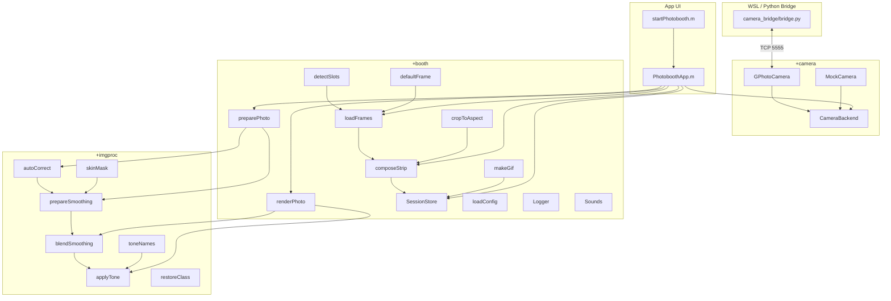

# MATLAB Photobooth + Beauty Implementation Plan

> **For agentic workers:** REQUIRED SUB-SKILL: Use superpowers:subagent-driven-development to implement this plan task-by-task. Steps use checkbox (`- [ ]`) syntax for tracking.

**Goal:** Build and unit-test the complete MATLAB Photobooth + Beauty kiosk application: image processing pipeline (`+imgproc`), booth services (`+booth`), WSL Python gphoto2 TCP bridge (`camera_bridge`), MATLAB camera backends (`+camera`), and the 5-screen `PhotoboothApp` uifigure kiosk UI.

**Architecture:** Pure image functions in `+imgproc`, stateless/lightweight booth utilities in `+booth`, a persistent Python TCP bridge (`camera_bridge/bridge.py`) wrapping `libgphoto2` in WSL, pluggable MATLAB camera backends (`+camera/CameraBackend`, `GPhotoCamera`, `MockCamera`), and a programmatic `uifigure` state-machine class `PhotoboothApp.m` launched via `startPhotobooth.m`. Skin smoothing is split into `prepareSmoothing` (computed once per photo) and `blendSmoothing` (driven interactively by the beauty slider).

**Architecture Diagram:**



**Tech Stack:** MATLAB R2024b, Image Processing Toolbox (`imbilatfilt`, `illumgray`, `chromadapt`, `adapthisteq`, `regionprops`, morphology), `matlab.unittest`, Python 3 (`python-gphoto2`, `Pillow`, `unittest`).

> [!IMPORTANT]
> **Running MATLAB:** every test command is `matlab -batch "runAllTests('<testFile>')"` run from the repo root `c:\Users\ArthurZ\Desktop\Mineaorz`. MATLAB fails to start inside the agent sandbox ("failed to load settings errors_warnings plugin"), so run MATLAB commands with `BypassSandbox: true`. Each run takes ~20–40 s for MATLAB to start up.

> [!NOTE]
> **Git:** the user is setting up their git identity. If `git commit` fails with "Author identity unknown", leave the changes staged, say so in your report, and keep going.

**Small differences from the spec (agreed simplifications, already written into the spec):**
- `FrameLibrary.m` is now two functions, `booth.loadFrames` + `booth.detectSlots`, because no state needs to persist between calls.
- The smoothness slider controls only the blend weight `a`. The bilateral strength is fixed (`DoS` 0.022, `sigmaS` 8 px per 1000 px), so moving the slider is instant.
- Tones are written as vectorized curves/matrices rather than literal 256-entry LUTs. They are equally fast in MATLAB and easier to read.

---

## File Structure

| File | Responsibility |
|---|---|
| `runAllTests.m` | Adds paths and runs all tests or one test file |
| `config.json` | Default runtime settings |
| `startPhotobooth.m` | Entry point: adds paths, loads config, opens `PhotoboothApp` |
| `PhotoboothApp.m` | Programmatic `uifigure` kiosk UI + 5-screen state machine + Gallery |
| `+imgproc/restoreClass.m` | Clamp to [0,1] and cast back to the input class |
| `+imgproc/toneNames.m` | Tone ids + Thai labels |
| `+imgproc/applyTone.m` | 6 tones, `preview`/`final` modes |
| `+imgproc/autoCorrect.m` | Gray-world WB + CLAHE on L |
| `+imgproc/skinMask.m` | Soft skin mask + debug stages |
| `+imgproc/prepareSmoothing.m` | Mask + bilateral layer (slow, once per photo) |
| `+imgproc/blendSmoothing.m` | Slider blend (fast) |
| `+imgproc/skinSmooth.m` | Convenience: prepare + blend |
| `+imgproc/debugSkinPipeline.m` | 6-panel figure for the report |
| `+booth/detectSlots.m` | Find 4 transparent windows and order them |
| `+booth/defaultFrame.m` | Built-in fallback frame |
| `+booth/loadFrames.m` | Load `frames/*.png` + `.json` |
| `+booth/cropToAspect.m` | Center crop |
| `+booth/composeStrip.m` | Photos into slots + frame overlay |
| `+booth/makeGif.m` | Looping GIF |
| `+booth/SessionStore.m` | Save/list sessions in `output/` |
| `+booth/loadConfig.m` | Defaults merged with `config.json` |
| `+booth/Logger.m` | Append to `logs/photobooth.log` |
| `+booth/Sounds.m` | Synthesized beep/shutter |
| `+booth/preparePhoto.m` | raw → resized/mirrored/corrected + smoothing prep |
| `+booth/renderPhoto.m` | prep + amount + tone → final photo |
| `+camera/CameraBackend.m` | Abstract base class (`start`, `getPreviewFrame`, `capture`, `stop`, `isReady`) |
| `+camera/MockCamera.m` | Cycles portrait images from `assets/mock/` with subtle live noise |
| `+camera/GPhotoCamera.m` | TCP client to `camera_bridge/bridge.py` (`PING`, `PREVIEW`, `CAPTURE`) |
| `camera_bridge/bridge.py` | TCP bridge server for `python-gphoto2` (plus `--fake` mode for testing) |
| `camera_bridge/test_bridge.py` | Python unit tests for bridge protocol and 3x camera reconnect |
| `camera_bridge/requirements.txt` | Python dependencies for WSL (`gphoto2`, `Pillow`, `numpy`) |
| `setup_camera.ps1` | PowerShell admin helper to `usbipd bind`/`attach` Nikon camera to WSL |
| `docs/hardware-checklist.md` | Step-by-step Nikon Z6II hardware setup and verification checklist |
| `tools/makeSampleFrames.m` | Writes 2 example frames to `frames/` |
| `tools/makeMockPhotos.m` | Writes 4 synthetic portrait images to `assets/mock/` |
| `tests/helpers/*.m` | Synthetic image/frame builders |
| `tests/test*.m` | One test class per unit |

---

### Task 1: Test runner, helpers, `restoreClass`

**Files:**
- Create: `runAllTests.m`, `tests/helpers/synthFace.m`, `tests/helpers/synthSkinStep.m`, `tests/helpers/makeAlpha.m`, `tests/helpers/synthFrame.m`, `tests/helpers/lumaOf.m`, `tests/helpers/edgeStep.m`
- Create: `+imgproc/restoreClass.m`
- Test: `tests/testRestoreClass.m`

- [ ] **Step 1: Create the test runner** `runAllTests.m`

```matlab
function results = runAllTests(target)
%RUNALLTESTS Run unit tests in tests/. Optional target = test file name
% without extension (e.g. 'testApplyTone'). Errors if any test fails.
% (Named runAllTests, not runTests, so it cannot shadow the built-in
% runtests on case-insensitive Windows file systems.)
root = fileparts(mfilename('fullpath'));
addpath(root, fullfile(root, 'tests', 'helpers'));
if nargin < 1 || isempty(target)
    suite = fullfile(root, 'tests');
else
    suite = fullfile(root, 'tests', [char(target) '.m']);
end
results = runtests(suite);
disp(table(results));
assertSuccess(results);
end
```

- [ ] **Step 2: Create test helpers**

`tests/helpers/synthFace.m`
```matlab
function [img, inside, background] = synthFace(n, noiseSigma)
%SYNTHFACE n-by-n RGB double image: skin-colored ellipse on a blue
% background, with optional Gaussian noise (fixed seed). inside = ellipse
% interior well away from its boundary; background = far from the face.
if nargin < 2, noiseSigma = 0; end
[X, Y] = meshgrid(1:n, 1:n);
c = (n + 1) / 2;
r = ((X - c) / (0.3*n)).^2 + ((Y - c) / (0.4*n)).^2;
face = r <= 1;
inside = r <= 0.5;
background = r >= 2;
skin = [224 172 138] / 255;   % YCbCr ~ (174, 105, 153): inside skin range
bg = [0.2 0.4 0.8];           % Cb ~ 180: outside skin range
img = zeros(n, n, 3);
for k = 1:3
    img(:,:,k) = face * skin(k) + ~face * bg(k);
end
rs = RandStream('mt19937ar', 'Seed', 42);
img = min(max(img + noiseSigma * randn(rs, size(img)), 0), 1);
end
```

`tests/helpers/synthSkinStep.m`
```matlab
function [img, c] = synthSkinStep(n)
%SYNTHSKINSTEP n-by-n image: left half light skin, right half darker skin.
% c = last column of the left half (the step is between c and c+1).
c = n / 2;
img = zeros(n, n, 3);
left = [224 172 138] / 255;
right = [150 100 75] / 255;
for k = 1:3
    img(:, 1:c, k) = left(k);
    img(:, c+1:end, k) = right(k);
end
end
```

`tests/helpers/makeAlpha.m`
```matlab
function alpha = makeAlpha(h, w, rects)
%MAKEALPHA Opaque h-by-w alpha with transparent holes at rects [x y w h].
alpha = ones(h, w);
for k = 1:size(rects, 1)
    r = rects(k,:);
    alpha(r(2):r(2)+r(4)-1, r(1):r(1)+r(3)-1) = 0;
end
end
```

`tests/helpers/synthFrame.m`
```matlab
function frame = synthFrame(h, w, rects)
%SYNTHFRAME Purple frame struct with holes at rects (already in slot order).
rgb = repmat(reshape([0.5 0.2 0.8], 1, 1, 3), h, w);
frame = struct('name', 'Test', 'tone', 'bw', 'path', '', 'rgb', rgb, ...
    'alpha', makeAlpha(h, w, rects), 'slots', rects);
end
```

`tests/helpers/lumaOf.m`
```matlab
function L = lumaOf(img)
%LUMAOF Rec.601 luma of an RGB image (double).
I = im2double(img);
L = 0.299*I(:,:,1) + 0.587*I(:,:,2) + 0.114*I(:,:,3);
end
```

`tests/helpers/edgeStep.m`
```matlab
function s = edgeStep(img)
%EDGESTEP Mean (over middle rows) of the largest horizontal luma jump
% between adjacent pixels. A sharp step keeps its full height; blur lowers it.
L = lumaOf(img);
n = size(L, 1);
rows = round(0.125*n):round(0.875*n);
d = abs(diff(L(rows,:), 1, 2));
s = mean(max(d, [], 2));
end
```

- [ ] **Step 3: Write the failing test** `tests/testRestoreClass.m`

```matlab
classdef testRestoreClass < matlab.unittest.TestCase
    methods (Test)
        function clampsAndCastsToUint8(tc)
            out = imgproc.restoreClass([-0.5 0.5 1.5], 'uint8');
            tc.verifyClass(out, 'uint8');
            tc.verifyEqual(out, uint8([0 128 255]));
        end
        function keepsDouble(tc)
            out = imgproc.restoreClass([-1 0.25 2], 'double');
            tc.verifyClass(out, 'double');
            tc.verifyEqual(out, [0 0.25 1]);
        end
        function castsSingle(tc)
            tc.verifyClass(imgproc.restoreClass(0.5, 'single'), 'single');
        end
    end
end
```

- [ ] **Step 4: Run to verify it fails**

Run: `matlab -batch "runAllTests('testRestoreClass')"`
Expected: FAIL, "Unable to resolve the name 'imgproc.restoreClass'".

- [ ] **Step 5: Implement** `+imgproc/restoreClass.m`

```matlab
function out = restoreClass(out, cls)
%RESTORECLASS Clamp a double image to [0,1] and cast it to class cls
% ('uint8' | 'uint16' | 'single' | 'double').
out = min(max(out, 0), 1);
switch cls
    case 'uint8',  out = im2uint8(out);
    case 'uint16', out = im2uint16(out);
    case 'single', out = single(out);
    otherwise,     out = double(out);
end
end
```

- [ ] **Step 6: Run to verify it passes**

Run: `matlab -batch "runAllTests('testRestoreClass')"`
Expected: 3 Passed, 0 Failed.

- [ ] **Step 7: Commit**

```bash
git add runAllTests.m tests/helpers +imgproc/restoreClass.m tests/testRestoreClass.m
git commit -m "feat: test runner, synthetic image helpers, restoreClass"
```

---

### Task 2: Tones (`toneNames`, `applyTone`)

**Files:**
- Create: `+imgproc/toneNames.m`, `+imgproc/applyTone.m`
- Test: `tests/testApplyTone.m`

- [ ] **Step 1: Write the failing test** `tests/testApplyTone.m`

```matlab
classdef testApplyTone < matlab.unittest.TestCase
    properties (TestParameter)
        tone = {'bw', 'warmFilm', 'pastel', 'vivid', 'cinematic', 'sepia'}
        mode = {'preview', 'final'}
    end
    methods (Test)
        function preservesSizeAndClass(tc, tone, mode)
            img = im2uint8(synthFace(64, 0.02));
            out = imgproc.applyTone(img, tone, mode);
            tc.verifyClass(out, 'uint8');
            tc.verifySize(out, size(img));
        end
        function bwIsGray(tc, mode)
            out = imgproc.applyTone(synthFace(64, 0.02), 'bw', mode);
            tc.verifyEqual(out(:,:,1), out(:,:,2));
            tc.verifyEqual(out(:,:,2), out(:,:,3));
        end
        function vividIncreasesSaturation(tc)
            img = synthFace(64);
            hsvIn = rgb2hsv(img);
            hsvOut = rgb2hsv(imgproc.applyTone(img, 'vivid', 'preview'));
            tc.verifyGreaterThan(mean(hsvOut(:,:,2), 'all'), mean(hsvIn(:,:,2), 'all'));
        end
        function warmFilmIsWarmer(tc)
            out = imgproc.applyTone(0.5 * ones(32, 32, 3), 'warmFilm', 'preview');
            tc.verifyGreaterThan(mean(out(:,:,1), 'all'), mean(out(:,:,3), 'all'));
        end
        function sepiaOrdersChannels(tc)
            out = imgproc.applyTone(0.5 * ones(8, 8, 3), 'sepia', 'preview');
            px = squeeze(out(4, 4, :));
            tc.verifyGreaterThan(px(1), px(2));
            tc.verifyGreaterThan(px(2), px(3));
        end
        function unknownToneFallsBackToBw(tc)
            img = synthFace(32);
            out = tc.verifyWarning(@() imgproc.applyTone(img, 'nope', 'preview'), 'imgproc:unknownTone');
            tc.verifyEqual(out, imgproc.applyTone(img, 'bw', 'preview'));
        end
        function toneNamesHasLabels(tc)
            [ids, labels] = imgproc.toneNames();
            tc.verifyEqual(ids, {'bw', 'warmFilm', 'pastel', 'vivid', 'cinematic', 'sepia'});
            tc.verifyNumElements(labels, numel(ids));
        end
    end
end
```

- [ ] **Step 2: Run to verify it fails**

Run: `matlab -batch "runAllTests('testApplyTone')"`
Expected: FAIL, "Unable to resolve the name 'imgproc.applyTone'".

- [ ] **Step 3: Implement** `+imgproc/toneNames.m`

```matlab
function [ids, labels] = toneNames()
%TONENAMES Supported tone ids (used in frame JSON) and Thai UI labels.
ids    = {'bw', 'warmFilm', 'pastel', 'vivid', 'cinematic', 'sepia'};
labels = {'ขาวดำ', 'ฟิล์มอุ่น', 'พาสเทล', 'สีสด', 'ซีเนมาติก', 'ซีเปีย'};
end
```

- [ ] **Step 4: Implement** `+imgproc/applyTone.m`

```matlab
function out = applyTone(img, name, mode)
%APPLYTONE Apply a named color tone (see imgproc.toneNames).
% mode 'preview' = fast curves/matrices only (for live view);
% mode 'final'   = also adds grain / vignette / glow.
% Unknown names fall back to 'bw' with warning imgproc:unknownTone.
% Returns the same class as img.
arguments
    img
    name {mustBeTextScalar}
    mode {mustBeMember(mode, {'preview', 'final'})} = 'preview'
end
I = im2double(img);
if size(I, 3) == 1, I = repmat(I, 1, 1, 3); end
name = char(name);
if ~ismember(name, imgproc.toneNames())
    warning('imgproc:unknownTone', 'Unknown tone "%s"; using bw.', name);
    name = 'bw';
end
isFinal = strcmp(mode, 'final');
s = max(size(I, 1), size(I, 2)) / 1000;   % resolution scale for blur sizes

switch name
    case 'bw'
        g = sCurve(luma(I), 0.6);
        if isFinal, g = g + grain(size(g), 0.02); end
        out = repmat(g, 1, 1, 3);
    case 'warmFilm'
        out = 0.06 + 0.94 * I;                 % lift blacks (faded film)
        out(:,:,1) = out(:,:,1) * 1.06;
        out(:,:,3) = out(:,:,3) * 0.90;
        out = sCurve(out, 0.3);
        if isFinal, out = vignette(out + grain([size(out,1) size(out,2)], 0.015), 0.25); end
    case 'pastel'
        out = I .^ 0.85;                       % brighten
        g = luma(out);
        out = g + 0.75 * (out - g);            % desaturate
        out = 0.5 + 0.85 * (out - 0.5);        % lower contrast
        out(:,:,1) = out(:,:,1) + 0.03;        % pink tint
        out(:,:,3) = out(:,:,3) + 0.015;
        if isFinal                             % soft glow (screen blend, 25%)
            blur = imgaussfilt(min(max(out, 0), 1), max(1, 8*s));
            out = 1 - (1 - out) .* (1 - 0.25 * blur);
        end
    case 'vivid'
        g = luma(I);
        out = sCurve(g + 1.35 * (I - g), 0.4);
    case 'cinematic'                           % teal shadows, orange highlights
        L = luma(I);
        teal   = reshape([-0.05 0.02 0.06], 1, 1, 3);
        orange = reshape([ 0.08 0.03 -0.06], 1, 1, 3);
        out = I + (1 - L).^2 .* teal + L.^2 .* orange;
        if isFinal, out = vignette(out, 0.2); end
    case 'sepia'
        M = [0.393 0.769 0.189; 0.349 0.686 0.168; 0.272 0.534 0.131];
        out = reshape(reshape(I, [], 3) * M.', size(I));
        if isFinal, out = vignette(out + grain([size(out,1) size(out,2)], 0.015), 0.3); end
end
out = imgproc.restoreClass(out, class(img));
end

function L = luma(I)
L = 0.299*I(:,:,1) + 0.587*I(:,:,2) + 0.114*I(:,:,3);
end

function y = sCurve(x, k)
% Blend of identity and a cosine S-curve; monotonic for k in [0,1].
x = min(max(x, 0), 1);
y = (1 - k) * x + k * (0.5 - 0.5 * cos(pi * x));
end

function n = grain(sz, sigma)
n = sigma * randn(sz);
end

function out = vignette(out, strength)
[h, w, ~] = size(out);
[X, Y] = meshgrid(linspace(-1, 1, w), linspace(-1, 1, h));
out = out .* (1 - strength * (X.^2 + Y.^2) / 2);
end
```

- [ ] **Step 5: Run to verify it passes**

Run: `matlab -batch "runAllTests('testApplyTone')"`
Expected: all Passed (12 parameterized + 2 bw + 5 others = 19), 0 Failed.

- [ ] **Step 6: Commit**

```bash
git add +imgproc/toneNames.m +imgproc/applyTone.m tests/testApplyTone.m
git commit -m "feat: six photobooth tones with preview/final modes"
```

---

### Task 3: `autoCorrect`

**Files:**
- Create: `+imgproc/autoCorrect.m`
- Test: `tests/testAutoCorrect.m`

- [ ] **Step 1: Write the failing test** `tests/testAutoCorrect.m`

```matlab
classdef testAutoCorrect < matlab.unittest.TestCase
    methods (Test)
        function removesColorCast(tc)
            g = repmat(linspace(0.2, 0.8, 64), 64, 1);
            img = cat(3, g * 0.8, g * 0.9, g * 1.15);   % blue cast on grays
            before = channelSpread(img);
            out = imgproc.autoCorrect(img);
            tc.verifyLessThan(channelSpread(out), 0.5 * before);
        end
        function preservesSizeAndClass(tc)
            img = im2uint8(synthFace(48, 0.02));
            out = imgproc.autoCorrect(img);
            tc.verifyClass(out, 'uint8');
            tc.verifySize(out, size(img));
        end
        function blackImageDoesNotError(tc)
            tc.verifySize(imgproc.autoCorrect(zeros(16, 16, 3)), [16 16 3]);
        end
    end
end

function s = channelSpread(img)
m = squeeze(mean(img, [1 2]));
s = max(m) - min(m);
end
```

- [ ] **Step 2: Run to verify it fails**

Run: `matlab -batch "runAllTests('testAutoCorrect')"`
Expected: FAIL, "Unable to resolve the name 'imgproc.autoCorrect'".

- [ ] **Step 3: Implement** `+imgproc/autoCorrect.m`

```matlab
function out = autoCorrect(img)
%AUTOCORRECT Gray-world white balance (illumgray + chromadapt in linear
% RGB), then gentle CLAHE on the Lab lightness channel only, so that
% contrast improves without shifting colors. Returns the input class.
I = im2double(img);
lin = rgb2lin(I);
if any(lin(:) > 0)
    illum = illumgray(lin, 2);           % ignore 2% darkest/brightest
    if all(isfinite(illum)) && all(illum > eps)
        lin = chromadapt(lin, illum, 'ColorSpace', 'linear-rgb');
    end
end
I = lin2rgb(min(max(lin, 0), 1));
lab = rgb2lab(I);
L = min(max(lab(:,:,1) / 100, 0), 1);
lab(:,:,1) = 100 * adapthisteq(L, 'ClipLimit', 0.005);
out = imgproc.restoreClass(lab2rgb(lab), class(img));
end
```

- [ ] **Step 4: Run to verify it passes**

Run: `matlab -batch "runAllTests('testAutoCorrect')"`
Expected: 3 Passed.

- [ ] **Step 5: Commit**

```bash
git add +imgproc/autoCorrect.m tests/testAutoCorrect.m
git commit -m "feat: gray-world white balance + Lab CLAHE auto correction"
```

---

### Task 4: `skinMask`

**Files:**
- Create: `+imgproc/skinMask.m`
- Test: `tests/testSkinMask.m`

- [ ] **Step 1: Write the failing test** `tests/testSkinMask.m`

```matlab
classdef testSkinMask < matlab.unittest.TestCase
    methods (Test)
        function findsFaceNotBackground(tc)
            [img, inside, bg] = synthFace(400, 0.03);
            M = imgproc.skinMask(img);
            tc.verifyGreaterThan(mean(M(inside)), 0.8);
            tc.verifyLessThan(mean(M(bg)), 0.05);
        end
        function maskIsSoftAndBounded(tc)
            M = imgproc.skinMask(synthFace(200));
            tc.verifySize(M, [200 200]);
            tc.verifyGreaterThanOrEqual(min(M(:)), 0);
            tc.verifyLessThanOrEqual(max(M(:)), 1);
        end
        function excludesStrongEdges(tc)
            [img, c] = synthSkinStep(400);
            [M, st] = imgproc.skinMask(img);
            tc.verifyTrue(all(st.edges(200, c:c+1)));
            tc.verifyLessThan(M(200, c), 0.5);
            tc.verifyGreaterThan(M(200, 50), 0.9);
        end
        function returnsStages(tc)
            [~, st] = imgproc.skinMask(synthFace(100));
            tc.verifyTrue(all(isfield(st, {'raw', 'cleaned', 'edges', 'hard'})));
        end
    end
end
```

- [ ] **Step 2: Run to verify it fails**

Run: `matlab -batch "runAllTests('testSkinMask')"`
Expected: FAIL, "Unable to resolve the name 'imgproc.skinMask'".

- [ ] **Step 3: Implement** `+imgproc/skinMask.m`

```matlab
function [M, stages] = skinMask(img)
%SKINMASK Soft skin mask M in [0,1] (same height/width as img).
%  1. YCbCr color threshold (Chai & Ngan 1999): Cb 77-127, Cr 133-173
%  2. Morphological cleanup: open -> close -> fill holes -> remove specks
%  3. Remove strong edges (gradient of smoothed Y) so eyes, brows, lips
%     and hairlines stay sharp
%  4. Feather with a Gaussian so the blend has no visible seams
% stages (for debugSkinPipeline): raw, cleaned, edges, hard (logical).
I8 = im2uint8(img);
ycc = rgb2ycbcr(I8);
Cb = ycc(:,:,2);
Cr = ycc(:,:,3);
raw = Cb >= 77 & Cb <= 127 & Cr >= 133 & Cr <= 173;

[h, w] = size(raw);
s = max(h, w) / 1000;                     % scale sizes with resolution
cleaned = imopen(raw, strel('disk', max(1, round(3*s))));
cleaned = imclose(cleaned, strel('disk', max(1, round(7*s))));
cleaned = imfill(cleaned, 'holes');
cleaned = bwareaopen(cleaned, max(1, round(0.002 * h * w)));

Y = im2double(ycc(:,:,1));
G = imgradient(imgaussfilt(Y, max(0.5, 1.5*s)));
v = sort(G(:));
t = max(v(max(1, round(0.85 * numel(v)))), 0.25);   % 85th pct, floor 0.25
edges = imdilate(G > t, strel('disk', max(1, round(s))));

hard = cleaned & ~edges;
M = min(max(imgaussfilt(double(hard), max(0.5, 4*s)), 0), 1);
stages = struct('raw', raw, 'cleaned', cleaned, 'edges', edges, 'hard', hard);
end
```

- [ ] **Step 4: Run to verify it passes**

Run: `matlab -batch "runAllTests('testSkinMask')"`
Expected: 4 Passed. If `findsFaceNotBackground` or `excludesStrongEdges` fails, do not just tune the numbers. First look at the stages (add `imwrite(st.raw, 'dbg_raw.png')` etc. in a scratch script), then adjust a single constant and write down why.

- [ ] **Step 5: Commit**

```bash
git add +imgproc/skinMask.m tests/testSkinMask.m
git commit -m "feat: YCbCr skin mask with morphology and edge exclusion"
```

---

### Task 5: Skin smoothing (`prepareSmoothing`, `blendSmoothing`, `skinSmooth`)

**Files:**
- Create: `+imgproc/prepareSmoothing.m`, `+imgproc/blendSmoothing.m`, `+imgproc/skinSmooth.m`
- Test: `tests/testSkinSmooth.m`

- [ ] **Step 1: Write the failing test** `tests/testSkinSmooth.m`

```matlab
classdef testSkinSmooth < matlab.unittest.TestCase
    methods (Test)
        function zeroAmountIsIdentity(tc)
            img = im2uint8(synthFace(120, 0.03));
            tc.verifyEqual(imgproc.skinSmooth(img, 0), img);
        end
        function reducesSkinNoise(tc)
            [img, inside] = synthFace(400, 0.03);
            out = imgproc.skinSmooth(img, 100);
            tc.verifyLessThan(varIn(out, inside), 0.5 * varIn(img, inside));
        end
        function keepsEdgesSharp(tc)
            img = synthSkinStep(400);
            before = edgeStep(img);
            tc.verifyGreaterThan(edgeStep(imgproc.skinSmooth(img, 100)), 0.8 * before);
            % sanity: the metric does detect blur
            tc.verifyLessThan(edgeStep(imgaussfilt(img, 4)), 0.5 * before);
        end
        function backgroundUntouched(tc)
            [img, ~, bg] = synthFace(400, 0.03);
            d = max(abs(imgproc.skinSmooth(img, 100) - img), [], 3);
            tc.verifyLessThan(mean(d(bg)), 0.01);
        end
        function blendIsMonotonic(tc)
            [img, inside] = synthFace(300, 0.03);
            prep = imgproc.prepareSmoothing(img);
            v = arrayfun(@(a) varIn(imgproc.blendSmoothing(prep, a), inside), [0 50 100]);
            tc.verifyTrue(issorted(v, 'descend'));
        end
        function rejectsOutOfRange(tc)
            prep = imgproc.prepareSmoothing(synthFace(50));
            tc.verifyError(@() imgproc.blendSmoothing(prep, 150), ?MException);
        end
    end
end

function v = varIn(img, mask)
L = lumaOf(img);
v = var(L(mask));
end
```

- [ ] **Step 2: Run to verify it fails**

Run: `matlab -batch "runAllTests('testSkinSmooth')"`
Expected: FAIL, "Unable to resolve the name 'imgproc.skinSmooth'".

- [ ] **Step 3: Implement** `+imgproc/prepareSmoothing.m`

```matlab
function prep = prepareSmoothing(img)
%PREPARESMOOTHING Precompute everything the beauty slider needs, so that
% moving the slider is only a cheap blend (imgproc.blendSmoothing).
%   prep.I      original image (double)
%   prep.M      soft skin mask (imgproc.skinMask)
%   prep.smooth edge-preserving smoothed layer + 30% fine texture
%   prep.cls    class of the input (restored on output)
% The bilateral filter runs on a copy at most 800 px on its long side
% (the smoothed layer is low-frequency, so upsampling it loses nothing),
% and fine texture from the full-resolution image is added back so skin
% does not look plastic.
I = im2double(img);
[h, w, ~] = size(I);
longSide = max(h, w);
M = imgproc.skinMask(I);

scale = min(1, 800 / longSide);
small = imresize(I, scale);
sigmaS = max(0.5, 8 * longSide * scale / 1000);   % 8 px per 1000 px
sm = imbilatfilt(small, 0.022, sigmaS);
if scale < 1
    sm = imresize(sm, [h w]);
end
sm = sm + 0.3 * (I - imgaussfilt(I, 1));

prep = struct('I', I, 'M', M, 'smooth', sm, 'cls', class(img));
end
```

- [ ] **Step 4: Implement** `+imgproc/blendSmoothing.m`

```matlab
function out = blendSmoothing(prep, amount)
%BLENDSMOOTHING out = I.*(1 - a*M) + smooth.*(a*M), with a = amount/100.
% amount = 0 returns the original image exactly.
arguments
    prep (1,1) struct
    amount (1,1) double {mustBeInRange(amount, 0, 100)}
end
W = (amount / 100) * prep.M;
out = prep.I .* (1 - W) + prep.smooth .* W;
out = imgproc.restoreClass(out, prep.cls);
end
```

- [ ] **Step 5: Implement** `+imgproc/skinSmooth.m`

```matlab
function out = skinSmooth(img, amount)
%SKINSMOOTH Edge-preserving skin smoothing, amount 0-100. One-shot
% convenience; for interactive sliders call prepareSmoothing once and
% blendSmoothing per slider change.
out = imgproc.blendSmoothing(imgproc.prepareSmoothing(img), amount);
end
```

- [ ] **Step 6: Run to verify it passes**

Run: `matlab -batch "runAllTests('testSkinSmooth')"`
Expected: 6 Passed.

- [ ] **Step 7: Commit**

```bash
git add +imgproc/prepareSmoothing.m +imgproc/blendSmoothing.m +imgproc/skinSmooth.m tests/testSkinSmooth.m
git commit -m "feat: edge-preserving skin smoothing with fast slider blend"
```

---

### Task 6: `debugSkinPipeline` (report figure)

**Files:**
- Create: `+imgproc/debugSkinPipeline.m`
- Test: `tests/testDebugSkinPipeline.m`

- [ ] **Step 1: Write the failing test** `tests/testDebugSkinPipeline.m`

```matlab
classdef testDebugSkinPipeline < matlab.unittest.TestCase
    methods (Test)
        function drawsSixPanels(tc)
            fig = imgproc.debugSkinPipeline(synthFace(200, 0.02), 70, false);
            tc.addTeardown(@() close(fig));
            tc.verifyNumElements(findobj(fig, 'Type', 'axes'), 6);
        end
    end
end
```

- [ ] **Step 2: Run to verify it fails**

Run: `matlab -batch "runAllTests('testDebugSkinPipeline')"`
Expected: FAIL, "Unable to resolve the name 'imgproc.debugSkinPipeline'".

- [ ] **Step 3: Implement** `+imgproc/debugSkinPipeline.m`

```matlab
function fig = debugSkinPipeline(img, amount, visible)
%DEBUGSKINPIPELINE Show every stage of the skin smoothing pipeline in a
% 2x3 figure (for the report / presentation):
%   original -> YCbCr skin -> morphology -> edge map -> final mask -> result
% Example: imgproc.debugSkinPipeline(imread('output/.../raw_1.jpg'), 70)
arguments
    img
    amount (1,1) double = 70
    visible (1,1) logical = true
end
[~, st] = imgproc.skinMask(img);
prep = imgproc.prepareSmoothing(img);
out = imgproc.blendSmoothing(prep, amount);

fig = figure('Name', 'Skin smoothing pipeline', ...
    'Visible', matlab.lang.OnOffSwitchState(visible));
tl = tiledlayout(fig, 2, 3, 'TileSpacing', 'compact');
panels = {img, st.raw, st.cleaned, st.edges, prep.M, out};
titles = {'1. Original', '2. YCbCr skin', '3. Morphology', ...
          '4. Edge map', '5. Final mask', sprintf('6. Result (%d)', round(amount))};
for k = 1:6
    ax = nexttile(tl);
    imshow(panels{k}, 'Parent', ax);
    title(ax, titles{k});
end
end
```

- [ ] **Step 4: Run to verify it passes**

Run: `matlab -batch "runAllTests('testDebugSkinPipeline')"`
Expected: 1 Passed.

- [ ] **Step 5: Commit**

```bash
git add +imgproc/debugSkinPipeline.m tests/testDebugSkinPipeline.m
git commit -m "feat: skin pipeline debug figure for report"
```

---

### Task 7: `detectSlots`

**Files:**
- Create: `+booth/detectSlots.m`
- Test: `tests/testDetectSlots.m`

- [ ] **Step 1: Write the failing test** `tests/testDetectSlots.m`

```matlab
classdef testDetectSlots < matlab.unittest.TestCase
    methods (Test)
        function stripOrderTopToBottom(tc)
            rects = [41 41 520 390; 41 471 520 390; 41 901 520 390; 41 1331 520 390];
            tc.verifyEqual(booth.detectSlots(makeAlpha(1800, 600, rects)), rects);
        end
        function gridOrderRowMajor(tc)
            rects = [40 40 540 720; 620 40 540 720; 40 800 540 720; 620 800 540 720];
            tc.verifyEqual(booth.detectSlots(makeAlpha(1800, 1200, rects)), rects);
        end
        function slightlyOffsetRowStillLeftToRight(tc)
            rects = [20 50 200 300; 260 65 200 300; 20 450 200 300; 260 450 200 300];
            tc.verifyEqual(booth.detectSlots(makeAlpha(800, 500, rects)), rects);
        end
        function ignoresTinySpecks(tc)
            rects = [41 41 520 390; 41 471 520 390; 41 901 520 390; 41 1331 520 390];
            alpha = makeAlpha(1800, 600, [rects; 5 5 3 3]);
            tc.verifyEqual(booth.detectSlots(alpha), rects);
        end
        function wrongCountErrors(tc)
            alpha = makeAlpha(800, 500, [20 50 200 300; 260 50 200 300; 20 450 200 300]);
            tc.verifyError(@() booth.detectSlots(alpha), 'booth:badSlotCount');
        end
    end
end
```

- [ ] **Step 2: Run to verify it fails**

Run: `matlab -batch "runAllTests('testDetectSlots')"`
Expected: FAIL, "Unable to resolve the name 'booth.detectSlots'".

- [ ] **Step 3: Implement** `+booth/detectSlots.m`

```matlab
function slots = detectSlots(alpha)
%DETECTSLOTS Find the 4 transparent photo windows in a frame's alpha
% channel (double, 0..1). Returns 4x4 [x y w h] in 1-based pixel coords,
% ordered row by row (top -> bottom), left -> right within a row. Slots
% whose centers differ by <= 10% of slot height count as the same row.
% Transparent regions smaller than 1% of the frame are ignored.
holes = alpha < 10/255;
stats = regionprops(bwconncomp(holes, 4), 'BoundingBox', 'Area', 'Centroid');
stats = stats([stats.Area] >= 0.01 * numel(alpha));
if numel(stats) ~= 4
    error('booth:badSlotCount', 'Expected 4 transparent slots, found %d.', numel(stats));
end
bb = vertcat(stats.BoundingBox);           % [x-0.5 y-0.5 w h]
slots = [bb(:,1:2) + 0.5, bb(:,3:4)];
c = vertcat(stats.Centroid);

[~, order] = sort(c(:,2));
slots = slots(order,:);
c = c(order,:);
rowId = ones(4, 1);
ref = c(1,2);
for k = 2:4
    if abs(c(k,2) - ref) > 0.1 * slots(k,4)
        ref = c(k,2);
        rowId(k) = rowId(k-1) + 1;
    else
        rowId(k) = rowId(k-1);
    end
end
[~, order] = sortrows([rowId c(:,1)]);
slots = slots(order,:);
end
```

- [ ] **Step 4: Run to verify it passes**

Run: `matlab -batch "runAllTests('testDetectSlots')"`
Expected: 5 Passed.

- [ ] **Step 5: Commit**

```bash
git add +booth/detectSlots.m tests/testDetectSlots.m
git commit -m "feat: auto-detect and order transparent frame slots"
```

---

### Task 8: `defaultFrame` and `loadFrames`

**Files:**
- Create: `+booth/defaultFrame.m`, `+booth/loadFrames.m`
- Test: `tests/testLoadFrames.m`

Frame struct fields (in this exact order, used everywhere): `name, tone, path, rgb (HxWx3 double), alpha (HxW double), slots (4x4 [x y w h])`.

- [ ] **Step 1: Write the failing test** `tests/testLoadFrames.m`

```matlab
classdef testLoadFrames < matlab.unittest.TestCase
    properties
        Dir
    end
    methods (TestMethodSetup)
        function makeDir(tc)
            tc.Dir = tc.applyFixture(matlab.unittest.fixtures.TemporaryFolderFixture).Folder;
        end
    end
    methods (Test)
        function loadsFrameWithMeta(tc)
            writeFrame(tc.Dir, 'cute', 4, '{"name":"Cute","tone":"pastel"}');
            frames = booth.loadFrames(tc.Dir);
            tc.verifyNumElements(frames, 1);
            tc.verifyEqual(frames.name, 'Cute');
            tc.verifyEqual(frames.tone, 'pastel');
            tc.verifySize(frames.slots, [4 4]);
            tc.verifySize(frames.rgb, [400 200 3]);
        end
        function defaultsWithoutJson(tc)
            writeFrame(tc.Dir, 'plain', 4, '');
            frames = booth.loadFrames(tc.Dir);
            tc.verifyEqual(frames.name, 'plain');
            tc.verifyEqual(frames.tone, 'bw');
        end
        function skipsBadFrameKeepsGood(tc)
            writeFrame(tc.Dir, 'good', 4, '');
            writeFrame(tc.Dir, 'bad', 3, '');
            [frames, problems] = tc.verifyWarning(@() booth.loadFrames(tc.Dir), 'booth:frameSkipped');
            tc.verifyEqual({frames.name}, {'good'});
            tc.verifyNumElements(problems, 1);
        end
        function unknownToneFallsBack(tc)
            writeFrame(tc.Dir, 'odd', 4, '{"tone":"neon"}');
            frames = tc.verifyWarning(@() booth.loadFrames(tc.Dir), 'booth:unknownTone');
            tc.verifyEqual(frames.tone, 'bw');
        end
        function emptyFolderUsesDefault(tc)
            frames = tc.verifyWarning(@() booth.loadFrames(tc.Dir), 'booth:noFrames');
            tc.verifyEqual(frames.name, 'Plain White');
            tc.verifySize(frames.slots, [4 4]);
            tc.verifySize(frames.rgb, [1800 600 3]);
        end
    end
end

function writeFrame(folder, base, nSlots, json)
h = 400; w = 200;
rects = [10 10 180 85; 10 105 180 85; 10 200 180 85; 10 295 180 85];
rgb = repmat(reshape([0.9 0.3 0.4], 1, 1, 3), h, w);
imwrite(rgb, fullfile(folder, [base '.png']), 'Alpha', makeAlpha(h, w, rects(1:nSlots,:)));
if ~isempty(json)
    fid = fopen(fullfile(folder, [base '.json']), 'w');
    fprintf(fid, '%s', json);
    fclose(fid);
end
end
```

- [ ] **Step 2: Run to verify it fails**

Run: `matlab -batch "runAllTests('testLoadFrames')"`
Expected: FAIL, "Unable to resolve the name 'booth.loadFrames'".

- [ ] **Step 3: Implement** `+booth/defaultFrame.m`

```matlab
function frame = defaultFrame()
%DEFAULTFRAME Built-in plain white 2x6" strip (600x1800, 4x1 slots),
% used when frames/ has no usable frame.
h = 1800; w = 600;
slots = [41 41 520 390; 41 471 520 390; 41 901 520 390; 41 1331 520 390];
alpha = ones(h, w);
for k = 1:4
    s = slots(k,:);
    alpha(s(2):s(2)+s(4)-1, s(1):s(1)+s(3)-1) = 0;
end
frame = struct('name', 'Plain White', 'tone', 'bw', 'path', '', ...
    'rgb', ones(h, w, 3), 'alpha', alpha, 'slots', slots);
end
```

- [ ] **Step 4: Implement** `+booth/loadFrames.m`

```matlab
function [frames, problems] = loadFrames(folder)
%LOADFRAMES Load every <name>.png (+ optional <name>.json) in folder.
% JSON: {"name": "Classic B&W", "tone": "bw"}; both keys optional
% (defaults: file name, 'bw'). Invalid frames are skipped with warning
% booth:frameSkipped and described in the cellstr problems. If nothing
% loads, warns booth:noFrames and returns booth.defaultFrame().
frames = struct('name', {}, 'tone', {}, 'path', {}, 'rgb', {}, 'alpha', {}, 'slots', {});
problems = {};
files = dir(fullfile(folder, '*.png'));
for k = 1:numel(files)
    p = fullfile(files(k).folder, files(k).name);
    try
        frames(end+1) = readFrame(p); %#ok<AGROW>
    catch err
        msg = sprintf('Skipping frame %s: %s', files(k).name, err.message);
        warning('booth:frameSkipped', '%s', msg);
        problems{end+1} = msg; %#ok<AGROW>
    end
end
if isempty(frames)
    warning('booth:noFrames', 'No usable frames in %s; using built-in frame.', folder);
    problems{end+1} = 'No usable frames; using built-in frame.';
    frames = booth.defaultFrame();
end
end

function f = readFrame(p)
[rgb, map, alpha] = imread(p);
if isempty(alpha)
    error('booth:noAlpha', 'PNG has no transparency (alpha channel).');
end
if ~isempty(map), rgb = ind2rgb(rgb, map); end
rgb = im2double(rgb);
if size(rgb, 3) == 1, rgb = repmat(rgb, 1, 1, 3); end
alpha = im2double(alpha);
slots = booth.detectSlots(alpha);
[folder, base] = fileparts(p);
[name, tone] = readMeta(fullfile(folder, [base '.json']), base);
f = struct('name', name, 'tone', tone, 'path', p, 'rgb', rgb, 'alpha', alpha, 'slots', slots);
end

function [name, tone] = readMeta(jsonPath, base)
name = base;
tone = 'bw';
if ~isfile(jsonPath), return; end
meta = jsondecode(fileread(jsonPath, 'Encoding', 'UTF-8'));
if isfield(meta, 'name'), name = char(meta.name); end
if isfield(meta, 'tone')
    if ismember(meta.tone, imgproc.toneNames())
        tone = char(meta.tone);
    else
        warning('booth:unknownTone', 'Frame %s: unknown tone "%s"; using bw.', base, meta.tone);
    end
end
end
```

- [ ] **Step 5: Run to verify it passes**

Run: `matlab -batch "runAllTests('testLoadFrames')"`
Expected: 5 Passed.

- [ ] **Step 6: Commit**

```bash
git add +booth/defaultFrame.m +booth/loadFrames.m tests/testLoadFrames.m
git commit -m "feat: load PNG frames with JSON meta and built-in fallback"
```

---

### Task 9: `cropToAspect` and `composeStrip`

**Files:**
- Create: `+booth/cropToAspect.m`, `+booth/composeStrip.m`
- Test: `tests/testComposeStrip.m`

- [ ] **Step 1: Write the failing test** `tests/testComposeStrip.m`

```matlab
classdef testComposeStrip < matlab.unittest.TestCase
    methods (Test)
        function placesPhotosInSlotsUnderFrame(tc)
            rects = [10 10 180 85; 10 105 180 85; 10 200 180 85; 10 295 180 85];
            frame = synthFrame(400, 200, rects);
            colors = [1 0 0; 0 1 0; 0 0 1; 1 1 0];
            photos = arrayfun(@(k) repmat(reshape(colors(k,:), 1, 1, 3), 300, 450), ...
                1:4, 'UniformOutput', false);
            out = booth.composeStrip(frame, photos);
            tc.verifySize(out, [400 200 3]);
            for k = 1:4
                r = rects(k,:);
                px = squeeze(out(r(2) + round(r(4)/2), r(1) + round(r(3)/2), :))';
                tc.verifyEqual(px, colors(k,:), 'AbsTol', 1e-3);
            end
            tc.verifyEqual(squeeze(out(2, 2, :))', [0.5 0.2 0.8], 'AbsTol', 1e-9);
        end
        function cropToAspectCentersWideImage(tc)
            img = zeros(100, 200, 3);
            img(:, 51:150, :) = 1;
            out = booth.cropToAspect(img, 1);
            tc.verifySize(out, [100 100 3]);
            tc.verifyEqual(min(out(:)), 1);
        end
        function cropToAspectTallTarget(tc)
            tc.verifySize(booth.cropToAspect(zeros(100, 200, 3), 0.5), [100 50 3]);
            tc.verifySize(booth.cropToAspect(zeros(200, 100, 3), 2), [50 100 3]);
        end
    end
end
```

- [ ] **Step 2: Run to verify it fails**

Run: `matlab -batch "runAllTests('testComposeStrip')"`
Expected: FAIL, "Unable to resolve the name 'booth.composeStrip'".

- [ ] **Step 3: Implement** `+booth/cropToAspect.m`

```matlab
function out = cropToAspect(img, aspect)
%CROPTOASPECT Center-crop img so that width/height == aspect.
[h, w, ~] = size(img);
if w / h > aspect
    newW = max(1, round(h * aspect));
    x0 = floor((w - newW) / 2);
    out = img(:, x0+1:x0+newW, :);
else
    newH = max(1, round(w / aspect));
    y0 = floor((h - newH) / 2);
    out = img(y0+1:y0+newH, :, :);
end
end
```

- [ ] **Step 4: Implement** `+booth/composeStrip.m`

```matlab
function out = composeStrip(frame, photos)
%COMPOSESTRIP Fill each slot of frame with photos{k} (center-cropped to
% the slot's aspect ratio, resized to fit), then overlay the frame using
% its alpha: out = canvas.*(1-alpha) + frame.rgb.*alpha.
% Output: double RGB, same size as frame.rgb.
[h, w, ~] = size(frame.rgb);
canvas = ones(h, w, 3);
for k = 1:size(frame.slots, 1)
    s = frame.slots(k,:);
    tile = booth.cropToAspect(im2double(photos{k}), s(3) / s(4));
    tile = min(max(imresize(tile, [s(4) s(3)]), 0), 1);
    canvas(s(2):s(2)+s(4)-1, s(1):s(1)+s(3)-1, :) = tile;
end
out = canvas .* (1 - frame.alpha) + frame.rgb .* frame.alpha;
end
```

- [ ] **Step 5: Run to verify it passes**

Run: `matlab -batch "runAllTests('testComposeStrip')"`
Expected: 3 Passed.

- [ ] **Step 6: Commit**

```bash
git add +booth/cropToAspect.m +booth/composeStrip.m tests/testComposeStrip.m
git commit -m "feat: compose photos into frame slots with alpha overlay"
```

---

### Task 10: `makeGif`

**Files:**
- Create: `+booth/makeGif.m`
- Test: `tests/testMakeGif.m`

- [ ] **Step 1: Write the failing test** `tests/testMakeGif.m`

```matlab
classdef testMakeGif < matlab.unittest.TestCase
    methods (Test)
        function writesLoopingGif(tc)
            d = tc.applyFixture(matlab.unittest.fixtures.TemporaryFolderFixture).Folder;
            p = fullfile(d, 'a.gif');
            photos = arrayfun(@(k) ones(120, 160, 3) * k / 5, 1:4, 'UniformOutput', false);
            booth.makeGif(photos, p, 0.6, 80);
            info = imfinfo(p);
            tc.verifyNumElements(info, 4);
            tc.verifyEqual(info(1).Width, 80);
        end
    end
end
```

- [ ] **Step 2: Run to verify it fails**

Run: `matlab -batch "runAllTests('testMakeGif')"`
Expected: FAIL, "Unable to resolve the name 'booth.makeGif'".

- [ ] **Step 3: Implement** `+booth/makeGif.m`

```matlab
function makeGif(photos, filePath, delaySeconds, longSide)
%MAKEGIF Write photos (cell of RGB images) as an endlessly looping GIF,
% each frame shown delaySeconds, downscaled so the long side <= longSide.
for k = 1:numel(photos)
    I = im2double(photos{k});
    scale = longSide / max(size(I, 1), size(I, 2));
    if scale < 1
        I = min(max(imresize(I, scale), 0), 1);
    end
    [ind, map] = rgb2ind(I, 256);
    if k == 1
        imwrite(ind, map, filePath, 'gif', 'LoopCount', Inf, 'DelayTime', delaySeconds);
    else
        imwrite(ind, map, filePath, 'gif', 'WriteMode', 'append', 'DelayTime', delaySeconds);
    end
end
end
```

- [ ] **Step 4: Run to verify it passes**

Run: `matlab -batch "runAllTests('testMakeGif')"`
Expected: 1 Passed.

- [ ] **Step 5: Commit**

```bash
git add +booth/makeGif.m tests/testMakeGif.m
git commit -m "feat: looping GIF export"
```

---

### Task 11: `Logger`, `loadConfig`, `config.json`

**Files:**
- Create: `+booth/Logger.m`, `+booth/loadConfig.m`, `config.json`
- Test: `tests/testLoggerConfig.m`

- [ ] **Step 1: Write the failing test** `tests/testLoggerConfig.m`

```matlab
classdef testLoggerConfig < matlab.unittest.TestCase
    properties
        Dir
    end
    methods (TestMethodSetup)
        function makeDir(tc)
            tc.Dir = tc.applyFixture(matlab.unittest.fixtures.TemporaryFolderFixture).Folder;
        end
    end
    methods (Test)
        function loggerAppendsLines(tc)
            p = fullfile(tc.Dir, 'logs', 'x.log');
            lg = booth.Logger(p);
            lg.info('hello %d', 1);
            lg.warn('careful');
            lg.err('boom');
            txt = fileread(p);
            tc.verifySubstring(txt, '[INFO] hello 1');
            tc.verifySubstring(txt, '[WARN] careful');
            tc.verifySubstring(txt, '[ERROR] boom');
        end
        function configDefaultsWhenMissing(tc)
            cfg = booth.loadConfig(fullfile(tc.Dir, 'none.json'));
            tc.verifyEqual(cfg.countdownSeconds, 3);
            tc.verifyEqual(cfg.camera, 'gphoto');
            tc.verifyEqual(cfg.defaultSmoothness, 40);
        end
        function configOverridesAndWarnsUnknown(tc)
            p = fullfile(tc.Dir, 'c.json');
            fid = fopen(p, 'w');
            fprintf(fid, '{"camera":"mock","countdownSeconds":5,"bogus":1}');
            fclose(fid);
            cfg = tc.verifyWarning(@() booth.loadConfig(p), 'booth:unknownConfigKey');
            tc.verifyEqual(cfg.camera, 'mock');
            tc.verifyEqual(cfg.countdownSeconds, 5);
            tc.verifyEqual(cfg.gapSeconds, 3);
        end
        function repoConfigIsValid(tc)
            root = fileparts(which('runAllTests'));
            cfg = tc.verifyWarningFree(@() booth.loadConfig(fullfile(root, 'config.json')));
            tc.verifyEqual(cfg.bridgePort, 5555);
        end
    end
end
```

- [ ] **Step 2: Run to verify it fails**

Run: `matlab -batch "runAllTests('testLoggerConfig')"`
Expected: FAIL, "Unable to resolve the name 'booth.Logger'".

- [ ] **Step 3: Implement** `+booth/Logger.m`

```matlab
classdef Logger < handle
    %LOGGER Append timestamped lines to a UTF-8 log file. Never throws
    % (logging must not crash the booth). Usage:
    %   lg = booth.Logger('logs/photobooth.log'); lg.warn('x=%d', 3);
    properties (SetAccess = immutable)
        FilePath (1,:) char
    end
    methods
        function obj = Logger(filePath)
            obj.FilePath = char(filePath);
            folder = fileparts(obj.FilePath);
            if ~isempty(folder) && ~isfolder(folder)
                mkdir(folder);
            end
        end
        function info(obj, fmt, varargin)
            obj.write('INFO', fmt, varargin{:});
        end
        function warn(obj, fmt, varargin)
            obj.write('WARN', fmt, varargin{:});
        end
        function err(obj, fmt, varargin)
            obj.write('ERROR', fmt, varargin{:});
        end
    end
    methods (Access = private)
        function write(obj, level, fmt, varargin)
            fid = fopen(obj.FilePath, 'a', 'n', 'UTF-8');
            if fid < 0, return; end
            closer = onCleanup(@() fclose(fid)); %#ok<NASGU>
            stamp = char(datetime('now', 'Format', 'yyyy-MM-dd HH:mm:ss'));
            fprintf(fid, '%s [%s] %s\n', stamp, level, sprintf(fmt, varargin{:}));
        end
    end
end
```

- [ ] **Step 4: Implement** `+booth/loadConfig.m`

```matlab
function cfg = loadConfig(filePath)
%LOADCONFIG Built-in defaults overridden by keys in a JSON file (if it
% exists). Unknown keys are ignored with warning booth:unknownConfigKey.
cfg = struct( ...
    'camera', 'gphoto', ...          % 'gphoto' | 'mock'
    'bridgePort', 5555, ...
    'countdownSeconds', 3, ...
    'gapSeconds', 3, ...
    'mirror', true, ...
    'idleTimeoutSeconds', 60, ...
    'workingLongSide', 2400, ...
    'reviewLongSide', 800, ...
    'gifDelaySeconds', 0.6, ...
    'defaultSmoothness', 40, ...
    'outputDir', 'output');
if nargin < 1 || ~isfile(filePath), return; end
user = jsondecode(fileread(filePath, 'Encoding', 'UTF-8'));
keys = fieldnames(user);
for k = 1:numel(keys)
    if isfield(cfg, keys{k})
        cfg.(keys{k}) = user.(keys{k});
    else
        warning('booth:unknownConfigKey', 'Ignoring unknown config key "%s".', keys{k});
    end
end
end
```

- [ ] **Step 5: Create** `config.json`

```json
{
  "camera": "gphoto",
  "bridgePort": 5555,
  "countdownSeconds": 3,
  "gapSeconds": 3,
  "mirror": true,
  "idleTimeoutSeconds": 60,
  "workingLongSide": 2400,
  "reviewLongSide": 800,
  "gifDelaySeconds": 0.6,
  "defaultSmoothness": 40,
  "outputDir": "output"
}
```

- [ ] **Step 6: Run to verify it passes**

Run: `matlab -batch "runAllTests('testLoggerConfig')"`
Expected: 4 Passed.

- [ ] **Step 7: Commit**

```bash
git add +booth/Logger.m +booth/loadConfig.m config.json tests/testLoggerConfig.m
git commit -m "feat: logger and JSON config with defaults"
```

---

### Task 12: `SessionStore`

**Files:**
- Create: `+booth/SessionStore.m`
- Test: `tests/testSessionStore.m`

- [ ] **Step 1: Write the failing test** `tests/testSessionStore.m`

```matlab
classdef testSessionStore < matlab.unittest.TestCase
    properties
        Dir
    end
    methods (TestMethodSetup)
        function makeDir(tc)
            tc.Dir = tc.applyFixture(matlab.unittest.fixtures.TemporaryFolderFixture).Folder;
        end
    end
    methods (Test)
        function savesAllFiles(tc)
            store = booth.SessionStore(fullfile(tc.Dir, 'out'));
            d = store.saveSession(sampleSession(tc.Dir));
            expected = [{'strip.png', 'animation.gif', 'meta.json'}, ...
                arrayfun(@(k) sprintf('raw_%d.jpg', k), 1:4, 'UniformOutput', false), ...
                arrayfun(@(k) sprintf('photo_%d.png', k), 1:4, 'UniformOutput', false)];
            for k = 1:numel(expected)
                tc.verifyTrue(isfile(fullfile(d, expected{k})), expected{k});
            end
            meta = jsondecode(fileread(fullfile(d, 'meta.json')));
            tc.verifyEqual(meta.frame, 'Test');
        end
        function listsNewestFirstWithoutCollisions(tc)
            store = booth.SessionStore(fullfile(tc.Dir, 'out'));
            d1 = store.saveSession(sampleSession(tc.Dir));
            d2 = store.saveSession(sampleSession(tc.Dir));
            tc.verifyNotEqual(d1, d2);
            list = store.listSessions();
            tc.verifyNumElements(list, 2);
            tc.verifyEqual(list(1).folder, d2);
            tc.verifyTrue(isfile(list(1).stripPath));
        end
        function emptyStoreListsNothing(tc)
            store = booth.SessionStore(fullfile(tc.Dir, 'empty'));
            tc.verifyEmpty(store.listSessions());
        end
    end
end

function s = sampleSession(tmp)
photos = arrayfun(@(k) ones(60, 80, 3) * k / 5, 1:4, 'UniformOutput', false);
rawPath = fullfile(tmp, 'raw_src.jpg');
imwrite(ones(60, 80, 3) * 0.5, rawPath);
s = struct('strip', ones(200, 100, 3) * 0.7, 'photos', {photos}, ...
    'raws', {{rawPath, ones(60, 80, 3), rawPath, ones(60, 80, 3)}}, ...
    'meta', struct('frame', 'Test', 'tone', 'bw', 'smoothness', 40, 'autoLight', true), ...
    'gifDelay', 0.6, 'gifLongSide', 80);
end
```

- [ ] **Step 2: Run to verify it fails**

Run: `matlab -batch "runAllTests('testSessionStore')"`
Expected: FAIL, "Unable to resolve the name 'booth.SessionStore'".

- [ ] **Step 3: Implement** `+booth/SessionStore.m`

```matlab
classdef SessionStore
    %SESSIONSTORE Save photobooth sessions to <Root>/yyyyMMdd_HHmmss[_n]/
    % and list them newest first (used by gallery and idle slideshow).
    % Session files: strip.png, animation.gif, raw_1..4.jpg,
    % photo_1..4.png, meta.json
    properties (SetAccess = immutable)
        Root (1,:) char
    end
    methods
        function obj = SessionStore(root)
            obj.Root = char(root);
            if ~isfolder(obj.Root)
                mkdir(obj.Root);
            end
        end

        function d = saveSession(obj, s)
            %SAVESESSION s fields: strip (image), photos (1x4 cell of
            % images), raws (1x4 cell; each a JPEG file path to copy or an
            % image to encode), meta (struct), gifDelay (s), gifLongSide (px)
            d = obj.newSessionFolder();
            imwrite(clamp01(s.strip), fullfile(d, 'strip.png'));
            for k = 1:numel(s.photos)
                imwrite(clamp01(s.photos{k}), fullfile(d, sprintf('photo_%d.png', k)));
                dst = fullfile(d, sprintf('raw_%d.jpg', k));
                raw = s.raws{k};
                if ischar(raw) || isstring(raw)
                    copyfile(raw, dst);
                else
                    imwrite(clamp01(raw), dst, 'Quality', 95);
                end
            end
            booth.makeGif(s.photos, fullfile(d, 'animation.gif'), s.gifDelay, s.gifLongSide);
            fid = fopen(fullfile(d, 'meta.json'), 'w', 'n', 'UTF-8');
            fprintf(fid, '%s', jsonencode(s.meta, 'PrettyPrint', true));
            fclose(fid);
        end

        function list = listSessions(obj)
            %LISTSESSIONS struct array (name, folder, stripPath), newest first.
            list = struct('name', {}, 'folder', {}, 'stripPath', {});
            ds = dir(obj.Root);
            ds = ds([ds.isdir] & ~startsWith({ds.name}, '.'));
            names = sort({ds.name});
            for k = numel(names):-1:1
                p = fullfile(obj.Root, names{k}, 'strip.png');
                if isfile(p)
                    list(end+1) = struct('name', names{k}, ...
                        'folder', fullfile(obj.Root, names{k}), 'stripPath', p); %#ok<AGROW>
                end
            end
        end
    end
    methods (Access = private)
        function d = newSessionFolder(obj)
            base = char(datetime('now', 'Format', 'yyyyMMdd_HHmmss'));
            d = fullfile(obj.Root, base);
            n = 2;
            while isfolder(d)
                d = fullfile(obj.Root, sprintf('%s_%d', base, n));
                n = n + 1;
            end
            mkdir(d);
        end
    end
end

function x = clamp01(x)
if isfloat(x)
    x = min(max(x, 0), 1);
end
end
```

- [ ] **Step 4: Run to verify it passes**

Run: `matlab -batch "runAllTests('testSessionStore')"`
Expected: 3 Passed.

- [ ] **Step 5: Commit**

```bash
git add +booth/SessionStore.m tests/testSessionStore.m
git commit -m "feat: session store for strips, gifs, raws and metadata"
```

---

### Task 13: `Sounds`

**Files:**
- Create: `+booth/Sounds.m`
- Test: `tests/testSounds.m`

- [ ] **Step 1: Write the failing test** `tests/testSounds.m`

```matlab
classdef testSounds < matlab.unittest.TestCase
    methods (Test)
        function wavesAreValidAudio(tc)
            waves = {booth.Sounds.beepWave(), booth.Sounds.beepWave(1320), booth.Sounds.shutterWave()};
            for k = 1:numel(waves)
                w = waves{k};
                tc.verifyTrue(iscolumn(w));
                tc.verifyNotEmpty(w);
                tc.verifyLessThanOrEqual(max(abs(w)), 1);
            end
        end
        function playDoesNotThrowWithoutAudioDevice(tc)
            booth.Sounds.beep();
            booth.Sounds.shutter();
            tc.verifyTrue(true);
        end
    end
end
```

- [ ] **Step 2: Run to verify it fails**

Run: `matlab -batch "runAllTests('testSounds')"`
Expected: FAIL, "Unable to resolve the name 'booth.Sounds.beepWave'".

- [ ] **Step 3: Implement** `+booth/Sounds.m`

```matlab
classdef Sounds
    %SOUNDS Synthesized booth sounds (no audio files needed).
    %   booth.Sounds.beep()       countdown tick (880 Hz)
    %   booth.Sounds.finalBeep()  last tick (1320 Hz)
    %   booth.Sounds.shutter()    camera shutter
    properties (Constant)
        Fs = 44100
    end
    methods (Static)
        function y = beepWave(freq)
            if nargin < 1, freq = 880; end
            fs = booth.Sounds.Fs;
            dur = 0.15;
            t = (0:round(dur * fs) - 1)' / fs;
            env = min(min(1, t / 0.005), (dur - t) / 0.03);   % 5 ms attack, 30 ms release
            y = 0.3 * sin(2 * pi * freq * t) .* max(env, 0);
        end
        function y = shutterWave()
            fs = booth.Sounds.Fs;
            rs = RandStream('mt19937ar', 'Seed', 7);
            n1 = round(0.012 * fs);
            n2 = round(0.06 * fs);
            click = randn(rs, n1, 1) .* exp(-(0:n1-1)' / (0.002 * fs));
            body = randn(rs, n2, 1) .* exp(-(0:n2-1)' / (0.015 * fs));
            y = [click; zeros(round(0.03 * fs), 1); body];
            y = 0.5 * y / max(abs(y));
        end
        function play(y)
            try
                sound(y, booth.Sounds.Fs);
            catch
                % no audio device: stay silent rather than crash the booth
            end
        end
        function beep()
            booth.Sounds.play(booth.Sounds.beepWave());
        end
        function finalBeep()
            booth.Sounds.play(booth.Sounds.beepWave(1320));
        end
        function shutter()
            booth.Sounds.play(booth.Sounds.shutterWave());
        end
    end
end
```

- [ ] **Step 4: Run to verify it passes**

Run: `matlab -batch "runAllTests('testSounds')"`
Expected: 2 Passed.

- [ ] **Step 5: Commit**

```bash
git add +booth/Sounds.m tests/testSounds.m
git commit -m "feat: synthesized countdown and shutter sounds"
```

---

### Task 14: Photo pipeline glue (`preparePhoto`, `renderPhoto`) + end-to-end core test

**Files:**
- Create: `+booth/preparePhoto.m`, `+booth/renderPhoto.m`
- Test: `tests/testCoreFlow.m`

- [ ] **Step 1: Write the failing test** `tests/testCoreFlow.m`

```matlab
classdef testCoreFlow < matlab.unittest.TestCase
    methods (Test)
        function rawToSavedStrip(tc)
            d = tc.applyFixture(matlab.unittest.fixtures.TemporaryFolderFixture).Folder;
            frame = booth.defaultFrame();
            raws = arrayfun(@(k) im2uint8(imresize(synthFace(450, 0.03), [450 600])), ...
                1:4, 'UniformOutput', false);
            photos = cell(1, 4);
            for k = 1:4
                prep = booth.preparePhoto(raws{k}, 400, true, true);
                tc.verifyEqual(max(size(prep.I, [1 2])), 400);
                photos{k} = booth.renderPhoto(prep, 40, 'warmFilm', 'final');
            end
            strip = booth.composeStrip(frame, photos);
            store = booth.SessionStore(fullfile(d, 'out'));
            store.saveSession(struct('strip', strip, 'photos', {photos}, 'raws', {raws}, ...
                'meta', struct('frame', frame.name, 'tone', 'warmFilm', 'smoothness', 40, 'autoLight', true), ...
                'gifDelay', 0.6, 'gifLongSide', 200));
            list = store.listSessions();
            tc.verifyNumElements(list, 1);
            tc.verifySize(imread(list(1).stripPath), [1800 600 3]);
        end
        function preparePhotoAcceptsFilePath(tc)
            d = tc.applyFixture(matlab.unittest.fixtures.TemporaryFolderFixture).Folder;
            p = fullfile(d, 'r.jpg');
            imwrite(synthFace(300), p);
            prep = booth.preparePhoto(p, 150, false, false);
            tc.verifySize(prep.I, [150 150 3]);
        end
        function mirrorFlipsHorizontally(tc)
            img = zeros(10, 20, 3);
            img(:, 1:5, :) = 1;
            prep = booth.preparePhoto(img, 100, true, false);
            tc.verifyEqual(prep.I(5, end, 1), 1, 'AbsTol', 1e-9);
            tc.verifyEqual(prep.I(5, 1, 1), 0, 'AbsTol', 1e-9);
        end
    end
end
```

- [ ] **Step 2: Run to verify it fails**

Run: `matlab -batch "runAllTests('testCoreFlow')"`
Expected: FAIL, "Unable to resolve the name 'booth.preparePhoto'".

- [ ] **Step 3: Implement** `+booth/preparePhoto.m`

```matlab
function prep = preparePhoto(raw, longSide, mirror, autoLight)
%PREPAREPHOTO Turn a captured photo into a smoothing-ready struct:
% load (if raw is a file path) -> downscale so the long side <= longSide
% -> optional mirror -> optional imgproc.autoCorrect ->
% imgproc.prepareSmoothing. Use longSide = cfg.reviewLongSide for the
% interactive review and cfg.workingLongSide for the final export.
if ischar(raw) || isstring(raw)
    raw = imread(raw);
end
I = im2double(raw);
scale = longSide / max(size(I, 1), size(I, 2));
if scale < 1
    I = min(max(imresize(I, scale), 0), 1);
end
if mirror
    I = fliplr(I);
end
if autoLight
    I = imgproc.autoCorrect(I);
end
prep = imgproc.prepareSmoothing(I);
end
```

- [ ] **Step 4: Implement** `+booth/renderPhoto.m`

```matlab
function out = renderPhoto(prep, amount, tone, mode)
%RENDERPHOTO Skin smoothing blend (amount 0-100) followed by the frame's
% tone. mode: 'preview' (review screen) or 'final' (export).
out = imgproc.applyTone(imgproc.blendSmoothing(prep, amount), tone, mode);
end
```

- [ ] **Step 5: Run to verify it passes**

Run: `matlab -batch "runAllTests('testCoreFlow')"`
Expected: 3 Passed.

- [ ] **Step 6: Run the full suite**

Run: `matlab -batch "runAllTests"`
Expected: every test class passes, 0 Failed.

- [ ] **Step 7: Commit**

```bash
git add +booth/preparePhoto.m +booth/renderPhoto.m tests/testCoreFlow.m
git commit -m "feat: photo pipeline glue and end-to-end core test"
```

---

### Task 15: Sample frames

**Files:**
- Create: `tools/makeSampleFrames.m`
- Generated: `frames/classic_strip.png`, `frames/classic_strip.json`, `frames/pastel_grid.png`, `frames/pastel_grid.json`

- [ ] **Step 1: Implement** `tools/makeSampleFrames.m`

```matlab
function makeSampleFrames(outDir)
%MAKESAMPLEFRAMES Write two example frames (PNG + JSON) that demonstrate
% the frame format. Real frames are designed by hand in any image editor:
% an RGBA PNG with exactly 4 fully transparent windows.
if nargin < 1
    outDir = fullfile(fileparts(fileparts(mfilename('fullpath'))), 'frames');
end
if ~isfolder(outDir), mkdir(outDir); end

% 1) Classic 2x6" strip (600x1800), 4x1, cream with a dark footer line.
rgb = repmat(reshape([0.97 0.95 0.90], 1, 1, 3), 1800, 600);
rgb(1740:1765, 60:540, :) = 0.15;
rects = [41 41 520 390; 41 471 520 390; 41 901 520 390; 41 1331 520 390];
writeFrame(outDir, 'classic_strip', rgb, rects, 'Classic B&W', 'bw');

% 2) 4x6" grid (1200x1800), 2x2, pastel pink with a footer band.
rgb = repmat(reshape([1.00 0.86 0.90], 1, 1, 3), 1800, 1200);
rgb(1600:1700, 100:1100, :) = repmat(reshape([0.98 0.62 0.70], 1, 1, 3), 101, 1001);
rects = [40 40 540 720; 620 40 540 720; 40 800 540 720; 620 800 540 720];
writeFrame(outDir, 'pastel_grid', rgb, rects, 'Pastel Dream', 'pastel');
end

function writeFrame(outDir, base, rgb, rects, name, tone)
[h, w, ~] = size(rgb);
alpha = ones(h, w);
for k = 1:size(rects, 1)
    r = rects(k,:);
    alpha(r(2):r(2)+r(4)-1, r(1):r(1)+r(3)-1) = 0;
end
imwrite(rgb, fullfile(outDir, [base '.png']), 'Alpha', alpha);
fid = fopen(fullfile(outDir, [base '.json']), 'w', 'n', 'UTF-8');
fprintf(fid, '%s', jsonencode(struct('name', name, 'tone', tone)));
fclose(fid);
end
```

- [ ] **Step 2: Generate and verify the frames load**

Run: `matlab -batch "addpath(pwd, fullfile(pwd,'tools')); makeSampleFrames; f = booth.loadFrames('frames'); disp({f.name}); disp({f.tone})"`
Expected output contains `{'Classic B&W'}  {'Pastel Dream'}` and `{'bw'}  {'pastel'}`, with no warnings.

- [ ] **Step 3: Commit**

```bash
git add tools/makeSampleFrames.m frames
git commit -m "feat: sample classic strip and pastel grid frames"
```

---

### Task 16: Python `gphoto2` TCP bridge, USB setup script, and hardware checklist

**Files:**
- Create: `camera_bridge/requirements.txt`, `camera_bridge/bridge.py`, `camera_bridge/test_bridge.py`, `setup_camera.ps1`, `docs/hardware-checklist.md`

- [ ] **Step 1: Write the failing Python test** `camera_bridge/test_bridge.py`

```python
import os
import socket
import tempfile
import threading
import unittest
from camera_bridge import bridge


class FlakyCamera(bridge.FakeCamera):
    def __init__(self, fail_times=0):
        super().__init__()
        self.fail_times = fail_times
        self.calls = 0

    def preview(self):
        self.calls += 1
        if self.calls <= self.fail_times:
            raise RuntimeError("USB PTP timeout")
        return super().preview()


class BridgeProtocolTests(unittest.TestCase):
    def start_server(self, cam):
        srv = bridge.BridgeServer(("127.0.0.1", 0), cam)
        port = srv.server_address[1]
        t = threading.Thread(target=srv.serve_forever, daemon=True)
        t.start()
        self.addCleanup(srv.shutdown)
        self.addCleanup(srv.server_close)
        return port

    def send_cmd(self, sock, line):
        sock.sendall((line + "\n").encode("ascii"))
        buf = b""
        while not buf.endswith(b"\n"):
            chunk = sock.recv(1)
            if not chunk:
                break
            buf += chunk
        return buf.decode("ascii").strip()

    def test_ping_status_preview_capture(self):
        port = self.start_server(bridge.FakeCamera(width=32, height=24))
        with socket.create_connection(("127.0.0.1", port), timeout=5) as s:
            self.assertEqual(self.send_cmd(s, "PING"), "OK pong")
            self.assertEqual(self.send_cmd(s, "STATUS"), "OK ready FakeNikonZ6II")

            hdr = self.send_cmd(s, "PREVIEW")
            parts = hdr.split()
            self.assertEqual(parts[:3], ["OK", "32", "24"])
            nbytes = int(parts[3])
            self.assertEqual(nbytes, 32 * 24 * 3)
            data = b""
            while len(data) < nbytes:
                data += s.recv(nbytes - len(data))
            self.assertEqual(len(data), nbytes)

            with tempfile.TemporaryDirectory() as d:
                out_path = os.path.join(d, "shot.jpg")
                resp = self.send_cmd(s, f"CAPTURE {out_path}")
                self.assertEqual(resp, f"OK {out_path}")
                self.assertTrue(os.path.isfile(out_path))
                self.assertGreater(os.path.getsize(out_path), 50)

    def test_reconnects_up_to_three_times(self):
        cam = FlakyCamera(fail_times=2)
        port = self.start_server(cam)
        with socket.create_connection(("127.0.0.1", port), timeout=5) as s:
            hdr = self.send_cmd(s, "PREVIEW")
            self.assertTrue(hdr.startswith("OK "))
            self.assertGreaterEqual(cam.reconnects, 2)

    def test_returns_err_after_three_failures(self):
        cam = FlakyCamera(fail_times=5)
        port = self.start_server(cam)
        with socket.create_connection(("127.0.0.1", port), timeout=5) as s:
            hdr = self.send_cmd(s, "PREVIEW")
            self.assertTrue(hdr.startswith("ERR "))


if __name__ == "__main__":
    unittest.main()
```

- [ ] **Step 2: Run the Python test to verify it fails**

Run: `python -m unittest discover -s camera_bridge -p "test_*.py" -v`
Expected: FAIL with `ImportError: cannot import name 'bridge' from 'camera_bridge'`.

- [ ] **Step 3: Create** `camera_bridge/requirements.txt` and `camera_bridge/bridge.py`

`camera_bridge/requirements.txt`
```text
gphoto2>=2.5.0
Pillow>=10.0.0
numpy>=1.26.0
```

`camera_bridge/bridge.py`
```python
#!/usr/bin/env python3
"""TCP bridge between MATLAB and libgphoto2 (or FakeCamera for testing).

Protocol (ASCII line requests, newline-terminated):
  PING                -> OK pong
  STATUS              -> OK <ready|disconnected> <model>
  PREVIEW             -> OK <w> <h> <nbytes>\\n + raw RGB uint8 (HWC)
  CAPTURE <path>      -> OK <path>
  QUIT                -> OK bye
"""
import argparse
import io
import os
import socketserver
import struct
import sys
import zlib


def _make_bmp_bytes(width, height, rgb_bytes):
    """Build a valid 24-bit uncompressed BMP in pure stdlib (no Pillow needed)."""
    row_raw = width * 3
    pad = (4 - (row_raw % 4)) % 4
    stride = row_raw + pad
    pix_size = stride * height
    file_size = 54 + pix_size
    header = struct.pack(
        "<2sIHHI IIIHHIIIIII",
        b"BM", file_size, 0, 0, 54,
        40, width, height, 1, 24, 0, pix_size, 2835, 2835, 0, 0,
    )
    rows = []
    for y in range(height - 1, -1, -1):
        row = bytearray()
        base = y * width * 3
        for x in range(width):
            r, g, b = rgb_bytes[base + 3 * x : base + 3 * x + 3]
            row.extend((b, g, r))
        row.extend(b"\x00" * pad)
        rows.append(bytes(row))
    return header + b"".join(rows)


def _make_png_bytes(width, height, rgb_bytes):
    """Build a valid 24-bit RGB PNG in pure stdlib so imread() always recognizes it."""
    def chunk(tag, data):
        crc = zlib.crc32(tag + data) & 0xFFFFFFFF
        return struct.pack(">I", len(data)) + tag + data + struct.pack(">I", crc)

    raw = bytearray()
    stride = width * 3
    for y in range(height):
        raw.append(0)
        raw.extend(rgb_bytes[y * stride : (y + 1) * stride])
    ihdr = struct.pack(">IIBBBBB", width, height, 8, 2, 0, 0, 0)
    return (
        b"\x89PNG\r\n\x1a\n"
        + chunk(b"IHDR", ihdr)
        + chunk(b"IDAT", zlib.compress(bytes(raw)))
        + chunk(b"IEND", b"")
    )


class FakeCamera:
    """In-memory camera adapter for unit/integration tests without hardware."""

    def __init__(self, width=64, height=48, sample_path=None):
        self.width = width
        self.height = height
        self.sample_path = sample_path
        self.model = "FakeNikonZ6II"
        self.connected = True
        self.reconnects = 0
        self.frame_index = 0

    def connect(self):
        self.connected = True

    def close(self):
        self.connected = False

    def reconnect(self):
        self.reconnects += 1
        self.close()
        self.connect()

    def preview(self):
        self.frame_index = (self.frame_index + 1) % 256
        w, h = self.width, self.height
        buf = bytearray(w * h * 3)
        idx = 0
        for y in range(h):
            for x in range(w):
                buf[idx] = (200 + self.frame_index) % 256
                buf[idx + 1] = (150 + x) % 256
                buf[idx + 2] = (120 + y) % 256
                idx += 3
        return w, h, bytes(buf)

    def capture(self, dest_path):
        folder = os.path.dirname(dest_path)
        if folder:
            os.makedirs(folder, exist_ok=True)
        if self.sample_path and os.path.isfile(self.sample_path):
            with open(self.sample_path, "rb") as src, open(dest_path, "wb") as dst:
                dst.write(src.read())
            return dest_path
        w, h, rgb = self.preview()
        try:
            from PIL import Image
            img = Image.frombytes("RGB", (w, h), rgb)
            img.save(dest_path, format="JPEG", quality=92)
        except Exception:
            with open(dest_path, "wb") as f:
                f.write(_make_png_bytes(w, h, rgb))
        return dest_path


class GPhotoCameraAdapter:
    """Real libgphoto2 adapter for Nikon Z6II in WSL."""

    def __init__(self, preview_width=960):
        self.preview_width = preview_width
        self.camera = None
        self.model = "NikonZ6II"
        self.connected = False
        self.connect()

    def connect(self):
        import gphoto2 as gp
        self.gp = gp
        self.camera = gp.Camera()
        self.camera.init()
        try:
            summary = str(self.camera.get_summary())
            for line in summary.splitlines():
                if line.lower().startswith("model:"):
                    self.model = line.split(":", 1)[1].strip().replace(" ", "_")
                    break
        except Exception:
            pass
        self.connected = True

    def close(self):
        self.connected = False
        if self.camera is not None:
            try:
                self.camera.exit()
            except Exception:
                pass
            self.camera = None

    def reconnect(self):
        self.close()
        self.connect()

    def preview(self):
        from PIL import Image
        if not self.connected or self.camera is None:
            self.connect()
        cam_file = self.camera.capture_preview()
        file_data = cam_file.get_data_and_size()
        img = Image.open(io.BytesIO(memoryview(file_data))).convert("RGB")
        if img.width > self.preview_width:
            new_h = max(1, round(img.height * (self.preview_width / img.width)))
            img = img.resize((self.preview_width, new_h), Image.BILINEAR)
        return img.width, img.height, img.tobytes()

    def capture(self, dest_path):
        if not self.connected or self.camera is None:
            self.connect()
        folder = os.path.dirname(dest_path)
        if folder:
            os.makedirs(folder, exist_ok=True)
        file_path = self.camera.capture(self.gp.GP_CAPTURE_IMAGE)
        cam_file = self.camera.file_get(
            file_path.folder, file_path.name, self.gp.GP_FILE_TYPE_NORMAL
        )
        cam_file.save(dest_path)
        return dest_path


class BridgeHandler(socketserver.StreamRequestHandler):
    def _run_with_retry(self, fn):
        last_err = None
        for _ in range(3):
            try:
                return fn()
            except Exception as exc:
                last_err = exc
                try:
                    self.server.camera.reconnect()
                except Exception:
                    pass
        raise RuntimeError(str(last_err))

    def handle(self):
        cam = self.server.camera
        while True:
            raw_line = self.rfile.readline()
            if not raw_line:
                break
            line = raw_line.decode("utf-8", errors="replace").strip()
            if not line:
                continue
            parts = line.split(" ", 1)
            cmd = parts[0].upper()
            arg = parts[1].strip() if len(parts) > 1 else ""
            try:
                if cmd == "PING":
                    self.wfile.write(b"OK pong\n")
                elif cmd == "STATUS":
                    state = "ready" if getattr(cam, "connected", False) else "disconnected"
                    self.wfile.write(f"OK {state} {cam.model}\n".encode("ascii"))
                elif cmd == "PREVIEW":
                    w, h, payload = self._run_with_retry(cam.preview)
                    header = f"OK {w} {h} {len(payload)}\n".encode("ascii")
                    self.wfile.write(header)
                    self.wfile.write(payload)
                elif cmd == "CAPTURE":
                    if not arg:
                        self.wfile.write(b"ERR missing capture path\n")
                    else:
                        out = self._run_with_retry(lambda: cam.capture(arg))
                        self.wfile.write(f"OK {out}\n".encode("utf-8"))
                elif cmd == "QUIT":
                    self.wfile.write(b"OK bye\n")
                    break
                else:
                    self.wfile.write(f"ERR unknown command {cmd}\n".encode("ascii"))
            except Exception as exc:
                msg = str(exc).replace("\n", " ")
                self.wfile.write(f"ERR {msg}\n".encode("utf-8"))
            self.wfile.flush()


class BridgeServer(socketserver.TCPServer):
    allow_reuse_address = True

    def __init__(self, server_address, camera):
        self.camera = camera
        super().__init__(server_address, BridgeHandler)


def main(argv=None):
    parser = argparse.ArgumentParser(description="Photobooth gphoto2 TCP bridge")
    parser.add_argument("--host", default="127.0.0.1")
    parser.add_argument("--port", type=int, default=5555)
    parser.add_argument("--fake", action="store_true", help="Use FakeCamera instead of gphoto2")
    parser.add_argument("--sample-jpg", default=None, help="Optional JPEG file for FakeCamera.capture")
    args = parser.parse_args(argv)

    cam = FakeCamera(sample_path=args.sample_jpg) if args.fake else GPhotoCameraAdapter()
    with BridgeServer((args.host, args.port), cam) as srv:
        print(f"BRIDGE_LISTENING {args.host}:{srv.server_address[1]}", flush=True)
        srv.serve_forever()


if __name__ == "__main__":
    sys.exit(main())
```

- [ ] **Step 4: Run the Python test to verify it passes**

Run: `python -m unittest discover -s camera_bridge -p "test_*.py" -v`
Expected: `Ran 3 tests ... OK`.

- [ ] **Step 5: Create** `setup_camera.ps1` and `docs/hardware-checklist.md`

`setup_camera.ps1`
```powershell
<#
.SYNOPSIS
Bind and attach a Nikon USB camera (VID 04b0) into WSL2 via usbipd-win,
then verify gphoto2 sees it. Must be run in an Administrator PowerShell.
#>
$ErrorActionPreference = "Stop"

if (-not (Get-Command usbipd -ErrorAction SilentlyContinue)) {
    Write-Error "usbipd-win is not installed. Run: winget install --exact dorssel.usbipd-win"
}

$lines = usbipd list
$nikon = $lines | Select-String -Pattern "04b0:|Nikon" | Select-Object -First 1
if (-not $nikon) {
    Write-Error "No Nikon USB device (VID 04b0) found. Turn on the Z6II and connect via USB."
}

$busId = ($nikon.Line -split "\s+")[0]
Write-Host "Found Nikon camera on BUSID $busId"
usbipd bind --busid $busId
usbipd attach --wsl --busid $busId

Write-Host "Verifying inside WSL..."
wsl gphoto2 --auto-detect
```

`docs/hardware-checklist.md`
```markdown
# Nikon Z6II Hardware Setup & Demo Checklist

## 1. One-Time Setup (Windows + WSL2)
1. Install `usbipd-win` on Windows (Admin PowerShell):
   ```powershell
   winget install --exact dorssel.usbipd-win
   ```
2. Inside WSL (Ubuntu), install `gphoto2` and Python dependencies:
   ```bash
   sudo apt update
   sudo apt install -y gphoto2 libgphoto2-dev python3-pip python3-pil python3-numpy
   pip3 install --break-system-packages gphoto2
   ```

## 2. Camera Settings (Nikon Z6II)
- **Image Quality:** JPEG Fine, Size L (or M for faster transfer).
- **Focus Mode:** `AF-S` with Auto-area AF (Face/Eye detection ON).
- **Power Saving:** Setup Menu → Power off timers → Standby timer = **No limit** (or 30 min).
- **USB Data Connection:** MTP/PTP.
- **Memory Card:** Insert a formatted SD/CFexpress card.

## 3. Before Every Demo Session
1. Turn on the Nikon Z6II and plug in the USB-C cable.
2. Close Nikon NX Tether / Webcam Utility if running on Windows.
3. Run PowerShell as Administrator in the repo root:
   ```powershell
   .\setup_camera.ps1
   ```
   Confirm `Nikon Z6_2` appears under `gphoto2 --auto-detect`.
4. In MATLAB, run:
   ```matlab
   startPhotobooth
   ```
5. Verify live preview runs at ~10–15 fps and test one 4-shot session.
6. If the camera cable is unplugged mid-event, re-run `.\setup_camera.ps1` and click **ลองใหม่ (Retry)** in the app, or click **ใช้โหมดสำรอง (Mock)** to continue without hardware.
```

- [ ] **Step 6: Commit**

```bash
git add camera_bridge setup_camera.ps1 docs/hardware-checklist.md
git commit -m "feat: Python gphoto2 TCP bridge, USB setup script, hardware checklist"
```

---

### Task 17: MATLAB Camera Backends (`CameraBackend`, `MockCamera`, `GPhotoCamera`, `makeMockPhotos`)

**Files:**
- Create: `+camera/CameraBackend.m`, `+camera/MockCamera.m`, `+camera/GPhotoCamera.m`, `tools/makeMockPhotos.m`
- Test: `tests/testCameraBackends.m`

- [ ] **Step 1: Write the failing test** `tests/testCameraBackends.m`

```matlab
classdef testCameraBackends < matlab.unittest.TestCase
    methods (Test)
        function mockCameraPreviewAndCaptureCycle(tc)
            d = tc.applyFixture(matlab.unittest.fixtures.TemporaryFolderFixture).Folder;
            mockDir = fullfile(d, 'mock');
            makeMockPhotos(mockDir);
            cam = camera.MockCamera(mockDir);
            cam.start();
            tc.addTeardown(@() cam.stop());
            tc.verifyTrue(cam.isReady());

            f1 = cam.getPreviewFrame();
            f2 = cam.getPreviewFrame();
            tc.verifyClass(f1, 'uint8');
            tc.verifySize(f1, [450 600 3]);
            tc.verifyNotEqual(f1, f2);   % subtle live noise differs each frame

            out1 = fullfile(d, 'shot1.jpg');
            res1 = cam.capture(out1);
            tc.verifyEqual(res1, out1);
            tc.verifyTrue(isfile(out1));
            img1 = imread(out1);
            tc.verifySize(img1, [450 600 3]);
        end

        function wslPathConversion(tc)
            p = camera.GPhotoCamera.toWslPath('C:\Users\ArthurZ\Desktop\shot.jpg');
            tc.verifyEqual(p, '/mnt/c/Users/ArthurZ/Desktop/shot.jpg');
        end

        function gphotoCameraTalksToPythonBridge(tc)
            d = tc.applyFixture(matlab.unittest.fixtures.TemporaryFolderFixture).Folder;
            sampleJpg = fullfile(d, 'sample.jpg');
            imwrite(im2uint8(synthFace(120, 0.02)), sampleJpg);

            root = fileparts(which('runAllTests'));
            bridgePy = fullfile(root, 'camera_bridge', 'bridge.py');
            port = 5560 + randi(200);
            cmd = sprintf('start "" /b python "%s" --fake --port %d --sample-jpg "%s"', ...
                bridgePy, port, sampleJpg);
            system(cmd);

            cam = camera.GPhotoCamera('Host', '127.0.0.1', 'Port', port, ...
                'AutoLaunch', false, 'UseWslPaths', false, 'ConnectTimeout', 5);
            tc.addTeardown(@() cam.stop());
            cam.start();
            tc.verifyTrue(cam.isReady());

            frame = cam.getPreviewFrame();
            tc.verifyClass(frame, 'uint8');
            tc.verifySize(frame, [48 64 3]);

            outJpg = fullfile(d, 'cap.jpg');
            got = cam.capture(outJpg);
            tc.verifyEqual(got, outJpg);
            tc.verifyTrue(isfile(outJpg));
            tc.verifySize(imread(outJpg), [120 120 3]);
        end
    end
end
```

- [ ] **Step 2: Run to verify it fails**

Run: `matlab -batch "runAllTests('testCameraBackends')"`
Expected: FAIL, "Unable to resolve the name 'makeMockPhotos'" or `'camera.MockCamera'`.

- [ ] **Step 3: Implement** `tools/makeMockPhotos.m`

```matlab
function makeMockPhotos(outDir)
%MAKEMOCKPHOTOS Write 4 synthetic 450x600 portrait JPEGs to assets/mock/
% so MockCamera has distinct poses/backgrounds out of the box.
if nargin < 1
    outDir = fullfile(fileparts(fileparts(mfilename('fullpath'))), 'assets', 'mock');
end
if ~isfolder(outDir), mkdir(outDir); end

bgs = [0.20 0.40 0.78; 0.25 0.62 0.52; 0.72 0.36 0.52; 0.48 0.38 0.72];
shifts = [-35 -15; 25 -10; -20 20; 30 15];
h = 450; w = 600;
[X, Y] = meshgrid(1:w, 1:h);
skin = [224 172 138] / 255;

for idx = 1:4
    cx = w/2 + shifts(idx, 1);
    cy = h/2 + shifts(idx, 2);
    r = ((X - cx) / 115).^2 + ((Y - cy) / 155).^2;
    face = r <= 1;
    eyes = (((X - (cx - 40)).^2 + (Y - (cy - 25)).^2) <= 14^2) | ...
           (((X - (cx + 40)).^2 + (Y - (cy - 25)).^2) <= 14^2);
    smile = (abs(X - cx) <= 42) & (abs((Y - (cy + 45)) - 0.008*(X - cx).^2) <= 5);
    features = eyes | smile;

    img = zeros(h, w, 3);
    for c = 1:3
        ch = face * skin(c) + ~face * bgs(idx, c);
        ch(features) = 0.15;
        img(:,:,c) = ch;
    end
    imwrite(im2uint8(img), fullfile(outDir, sprintf('mock_%d.jpg', idx)), 'Quality', 95);
end
end
```

- [ ] **Step 4: Implement** `+camera/CameraBackend.m`, `+camera/MockCamera.m`, `+camera/GPhotoCamera.m`

`+camera/CameraBackend.m`
```matlab
classdef (Abstract) CameraBackend < handle
    %CAMERABACKEND Common interface for GPhotoCamera and MockCamera.
    methods (Abstract)
        start(obj)
        stop(obj)
        tf = isReady(obj)
        frame = getPreviewFrame(obj)
        outPath = capture(obj, outPath)
    end
end
```

`+camera/MockCamera.m`
```matlab
classdef MockCamera < camera.CameraBackend
    %MOCKCAMERA Cycles through images in assets/mock/ (or synthetic faces
    % if none exist), adding slight per-frame noise in getPreviewFrame().
    properties (SetAccess = private)
        Folder (1,:) char
        Images (1,:) cell = {}
        Index (1,1) double = 1
        Ready (1,1) logical = false
    end
    methods
        function obj = MockCamera(folder)
            if nargin < 1 || isempty(folder)
                root = fileparts(fileparts(mfilename('fullpath')));
                folder = fullfile(root, 'assets', 'mock');
            end
            obj.Folder = char(folder);
        end

        function start(obj)
            files = [dir(fullfile(obj.Folder, '*.jpg')); dir(fullfile(obj.Folder, '*.png'))];
            obj.Images = cell(1, numel(files));
            for k = 1:numel(files)
                obj.Images{k} = im2uint8(imread(fullfile(files(k).folder, files(k).name)));
            end
            if isempty(obj.Images)
                [X, Y] = meshgrid(1:600, 1:450);
                face = ((X - 300)/115).^2 + ((Y - 225)/155).^2 <= 1;
                skin = [224 172 138] / 255;
                bg = [0.2 0.4 0.8];
                img = cat(3, face*skin(1) + ~face*bg(1), ...
                             face*skin(2) + ~face*bg(2), ...
                             face*skin(3) + ~face*bg(3));
                obj.Images = {im2uint8(img)};
            end
            obj.Index = 1;
            obj.Ready = true;
        end

        function stop(obj)
            obj.Ready = false;
        end

        function tf = isReady(obj)
            tf = obj.Ready;
        end

        function frame = getPreviewFrame(obj)
            if ~obj.Ready, obj.start(); end
            base = im2double(obj.Images{obj.Index});
            noisy = min(max(base + 0.008 * randn(size(base)), 0), 1);
            frame = im2uint8(noisy);
        end

        function outPath = capture(obj, outPath)
            if ~obj.Ready, obj.start(); end
            img = obj.Images{obj.Index};
            obj.Index = mod(obj.Index, numel(obj.Images)) + 1;
            if nargin >= 2 && ~isempty(outPath)
                folder = fileparts(char(outPath));
                if ~isempty(folder) && ~isfolder(folder), mkdir(folder); end
                imwrite(img, char(outPath), 'Quality', 95);
            else
                outPath = img;
            end
        end
    end
end
```

`+camera/GPhotoCamera.m`
```matlab
classdef GPhotoCamera < camera.CameraBackend
    %GPHOTOCAMERA Talks to camera_bridge/bridge.py over TCP.
    properties (SetAccess = private)
        Host (1,:) char = '127.0.0.1'
        Port (1,1) double = 5555
        AutoLaunch (1,1) logical = true
        UseWslPaths (1,1) logical = true
        ConnectTimeout (1,1) double = 10
        Client = []
        Ready (1,1) logical = false
    end
    methods
        function obj = GPhotoCamera(opts)
            arguments
                opts.Host (1,:) char = '127.0.0.1'
                opts.Port (1,1) double = 5555
                opts.AutoLaunch (1,1) logical = true
                opts.UseWslPaths (1,1) logical = true
                opts.ConnectTimeout (1,1) double = 10
            end
            obj.Host = opts.Host;
            obj.Port = opts.Port;
            obj.AutoLaunch = opts.AutoLaunch;
            obj.UseWslPaths = opts.UseWslPaths;
            obj.ConnectTimeout = opts.ConnectTimeout;
        end

        function start(obj)
            if obj.tryConnect()
                return;
            end
            if obj.AutoLaunch
                root = fileparts(fileparts(mfilename('fullpath')));
                wslScript = camera.GPhotoCamera.toWslPath(fullfile(root, 'camera_bridge', 'bridge.py'));
                cmd = sprintf('start "" /b wsl python3 "%s" --port %d', wslScript, obj.Port);
                system(cmd);
            end
            t0 = tic;
            while toc(t0) < obj.ConnectTimeout
                pause(0.25);
                if obj.tryConnect()
                    return;
                end
            end
            error('camera:connectFailed', ...
                'Could not connect to gphoto2 bridge on %s:%d.', obj.Host, obj.Port);
        end

        function stop(obj)
            if ~isempty(obj.Client)
                try
                    writeline(obj.Client, 'QUIT');
                catch
                end
            end
            obj.Client = [];
            obj.Ready = false;
        end

        function tf = isReady(obj)
            tf = obj.Ready && ~isempty(obj.Client);
        end

        function frame = getPreviewFrame(obj)
            if ~obj.isReady()
                error('camera:notReady', 'GPhotoCamera is not connected.');
            end
            writeline(obj.Client, 'PREVIEW');
            hdr = char(readline(obj.Client));
            if ~startsWith(hdr, 'OK ')
                error('camera:previewFailed', 'Bridge preview failed: %s', hdr);
            end
            vals = sscanf(hdr(4:end), '%d %d %d');
            w = vals(1); h = vals(2); nbytes = vals(3);
            raw = read(obj.Client, nbytes, 'uint8');
            frame = permute(reshape(uint8(raw), [3, w, h]), [3, 2, 1]);
        end

        function outPath = capture(obj, outPath)
            if ~obj.isReady()
                error('camera:notReady', 'GPhotoCamera is not connected.');
            end
            outPath = char(outPath);
            folder = fileparts(outPath);
            if ~isempty(folder) && ~isfolder(folder), mkdir(folder); end
            remotePath = outPath;
            if obj.UseWslPaths
                remotePath = camera.GPhotoCamera.toWslPath(outPath);
            end
            writeline(obj.Client, ['CAPTURE ' remotePath]);
            resp = char(readline(obj.Client));
            if ~startsWith(resp, 'OK ')
                error('camera:captureFailed', 'Bridge capture failed: %s', resp);
            end
        end
    end
    methods (Access = private)
        function ok = tryConnect(obj)
            ok = false;
            try
                c = tcpclient(obj.Host, obj.Port, 'Timeout', 5);
                configureTerminator(c, 'LF');
                writeline(c, 'PING');
                resp = strtrim(char(readline(c)));
                if strcmp(resp, 'OK pong')
                    obj.Client = c;
                    obj.Ready = true;
                    ok = true;
                end
            catch
                obj.Client = [];
                obj.Ready = false;
            end
        end
    end
    methods (Static)
        function wsl = toWslPath(winPath)
            p = strrep(char(winPath), '\', '/');
            if numel(p) >= 2 && p(2) == ':'
                drive = lower(p(1));
                wsl = ['/mnt/' drive p(3:end)];
            else
                wsl = p;
            end
        end
    end
end
```

- [ ] **Step 5: Generate mock photos and run `testCameraBackends`**

Run: `matlab -batch "addpath(pwd, fullfile(pwd,'tools')); makeMockPhotos; runAllTests('testCameraBackends')"`
Expected: 3 Passed, 0 Failed.

- [ ] **Step 6: Commit**

```bash
git add +camera tools/makeMockPhotos.m assets/mock tests/testCameraBackends.m
git commit -m "feat: CameraBackend, MockCamera, GPhotoCamera and mock portraits"
```

---

### Task 18: `PhotoboothApp.m`, `startPhotobooth.m`, and Full Kiosk Flow Test

**Files:**
- Create: `PhotoboothApp.m`, `startPhotobooth.m`
- Test: `tests/testPhotoboothApp.m`

- [ ] **Step 1: Write the failing test** `tests/testPhotoboothApp.m`

```matlab
classdef testPhotoboothApp < matlab.unittest.TestCase
    properties
        Dir
    end
    methods (TestMethodSetup)
        function makeDir(tc)
            tc.Dir = tc.applyFixture(matlab.unittest.fixtures.TemporaryFolderFixture).Folder;
        end
    end
    methods (Test)
        function fullBoothFlowWithRetakeAndGallery(tc)
            cfg = booth.loadConfig();
            cfg.camera = 'mock';
            cfg.outputDir = fullfile(tc.Dir, 'out');
            cfg.workingLongSide = 400;
            cfg.reviewLongSide = 200;

            app = PhotoboothApp(cfg, 'Visible', false, 'AutoTimers', false);
            tc.addTeardown(@() delete(app));

            tc.verifyEqual(app.Screen, 'idle');
            app.goToChooseFrame();
            tc.verifyEqual(app.Screen, 'chooseFrame');
            app.selectFrame(min(2, numel(app.Frames)));

            app.captureAllNow();
            tc.verifyEqual(app.Screen, 'review');
            tc.verifyNumElements(app.RawFiles, 4);

            % Adjust beauty controls and retake slot 2
            app.setSmoothness(75);
            tc.verifyEqual(app.Smoothness, 75);
            app.setAutoLight(false);
            tc.verifyFalse(app.AutoLight);
            app.setAutoLight(true);
            app.setComparing(true);
            app.setComparing(false);

            app.retakeSlotNow(2);
            tc.verifyEqual(app.Screen, 'review');

            % Complete review -> saves session and transitions to result
            app.finishReview();
            tc.verifyEqual(app.Screen, 'result');
            list = app.Store.listSessions();
            tc.verifyNumElements(list, 1);
            tc.verifyTrue(isfile(fullfile(list(1).folder, 'strip.png')));
            tc.verifyTrue(isfile(fullfile(list(1).folder, 'animation.gif')));
            meta = jsondecode(fileread(fullfile(list(1).folder, 'meta.json')));
            tc.verifyEqual(meta.smoothness, 75);

            % Gallery and idle timeout
            app.goToGallery();
            tc.verifyEqual(app.Screen, 'gallery');
            app.onIdleTimeout();
            tc.verifyEqual(app.Screen, 'idle');
        end

        function cameraFailureShowsBannerAndFallbackWorks(tc)
            cfg = booth.loadConfig();
            cfg.camera = 'gphoto';
            cfg.bridgePort = 5599;   % nothing listening
            cfg.outputDir = fullfile(tc.Dir, 'out');

            app = PhotoboothApp(cfg, 'Visible', false, 'AutoTimers', false, 'ConnectTimeout', 0.3);
            tc.addTeardown(@() delete(app));

            tc.verifyTrue(app.CameraBannerVisible);
            app.useMockCamera();
            tc.verifyFalse(app.CameraBannerVisible);
            tc.verifyTrue(app.Camera.isReady());
        end
    end
end
```

- [ ] **Step 2: Run to verify it fails**

Run: `matlab -batch "runAllTests('testPhotoboothApp')"`
Expected: FAIL, "Unable to resolve the name 'PhotoboothApp'".

- [ ] **Step 3: Implement** `PhotoboothApp.m` and `startPhotobooth.m`

`PhotoboothApp.m`
```matlab
classdef PhotoboothApp < handle
    %PHOTOBOOTHAPP Fullscreen kiosk UI + state machine for MATLAB Photobooth.
    % Screens: 'idle' | 'gallery' | 'chooseFrame' | 'shooting' | 'review' | 'result'
    properties (SetAccess = private)
        Config struct
        RootDir (1,:) char
        Logger booth.Logger
        Store booth.SessionStore
        Frames struct
        SelectedFrameIdx (1,1) double = 1
        Camera = []
        Screen (1,:) char = 'idle'
        RawFiles (1,4) cell = {'', '', '', ''}
        ReviewPreps (1,4) cell = {[], [], [], []}
        SelectedPhotoIdx (1,1) double = 1
        Smoothness (1,1) double = 40
        AutoLight (1,1) logical = true
        Comparing (1,1) logical = false
        RetakeTarget (1,1) double = 0
        CurrentShotIdx (1,1) double = 1
        LastStrip = []
        LastPhotos (1,4) cell = {[], [], [], []}
        CameraBannerVisible (1,1) logical = false
        SaveErrorVisible (1,1) logical = false
        AutoTimers (1,1) logical = true
    end
    properties (Access = private)
        Fig
        Panels struct
        Widgets struct
        PreviewTimer = []
        IdleTimer = []
        SlideTimer = []
        SlideIdx (1,1) double = 1
        ConnectTimeout (1,1) double = 2
    end

    methods
        function obj = PhotoboothApp(cfg, opts)
            arguments
                cfg struct = booth.loadConfig()
                opts.Visible (1,1) logical = true
                opts.AutoTimers (1,1) logical = true
                opts.ConnectTimeout (1,1) double = 2
            end
            obj.RootDir = fileparts(mfilename('fullpath'));
            obj.Config = cfg;
            obj.Smoothness = cfg.defaultSmoothness;
            obj.AutoTimers = opts.AutoTimers;
            obj.ConnectTimeout = opts.ConnectTimeout;

            logPath = fullfile(obj.RootDir, 'logs', 'photobooth.log');
            obj.Logger = booth.Logger(logPath);
            outDir = cfg.outputDir;
            if ~ startsWith(outDir, {'/', '\'}) && (numel(outDir) < 2 || outDir(2) ~= ':')
                outDir = fullfile(obj.RootDir, outDir);
            end
            obj.Store = booth.SessionStore(outDir);
            [obj.Frames, problems] = booth.loadFrames(fullfile(obj.RootDir, 'frames'));
            for k = 1:numel(problems)
                obj.Logger.warn('%s', problems{k});
            end

            obj.buildUI(opts.Visible);
            obj.initCamera();
            obj.goToIdle();
        end

        function delete(obj)
            obj.stopAllTimers();
            if ~isempty(obj.Camera)
                try obj.Camera.stop(); catch, end
            end
            if ~isempty(obj.Fig) && isvalid(obj.Fig)
                delete(obj.Fig);
            end
        end

        function goToIdle(obj)
            obj.stopAllTimers();
            obj.showScreen('idle');
            obj.refreshIdleSlide();
            if obj.AutoTimers
                obj.SlideTimer = timer('ExecutionMode', 'fixedRate', 'Period', 4.0, ...
                    'TimerFcn', @(~,~) obj.refreshIdleSlide());
                start(obj.SlideTimer);
            end
        end

        function goToGallery(obj)
            obj.stopAllTimers();
            obj.showScreen('gallery');
            obj.refreshGallery();
            obj.restartIdleTimer();
        end

        function goToChooseFrame(obj)
            obj.stopAllTimers();
            obj.showScreen('chooseFrame');
            obj.selectFrame(obj.SelectedFrameIdx);
            obj.startPreviewLoop();
            obj.restartIdleTimer();
        end

        function selectFrame(obj, idx)
            obj.SelectedFrameIdx = max(1, min(idx, numel(obj.Frames)));
            f = obj.Frames(obj.SelectedFrameIdx);
            obj.Widgets.FrameInfoLabel.Text = sprintf('กรอบ: %s   |   โทน: %s', f.name, f.tone);
            PreviewThumb = booth.composeStrip(f, repmat({ones(120, 160, 3)*0.85}, 1, 4));
            obj.Widgets.FramePreviewImg.ImageSource = im2uint8(PreviewThumb);
            obj.updateLivePreview();
            obj.restartIdleTimer();
        end

        function startShooting(obj)
            obj.stopAllTimers();
            obj.RetakeTarget = 0;
            obj.RawFiles = {'', '', '', ''};
            for k = 1:4
                obj.Widgets.ShootThumbs(k).ImageSource = zeros(90, 120, 3, 'uint8') + 40;
            end
            obj.showScreen('shooting');
            if obj.AutoTimers
                obj.runShootSequence(1:4);
            end
        end

        function captureAllNow(obj)
            %CAPTUREALLNOW Synchronous 4-shot capture (used by tests and instant mode).
            obj.stopAllTimers();
            obj.RetakeTarget = 0;
            obj.showScreen('shooting');
            for k = 1:4
                obj.captureOneSlot(k);
            end
            obj.enterReview(true);
        end

        function startRetake(obj, slotIdx)
            obj.stopAllTimers();
            obj.RetakeTarget = slotIdx;
            obj.showScreen('shooting');
            if obj.AutoTimers
                obj.runShootSequence(slotIdx);
            end
        end

        function retakeSlotNow(obj, slotIdx)
            obj.stopAllTimers();
            obj.RetakeTarget = slotIdx;
            obj.showScreen('shooting');
            obj.captureOneSlot(slotIdx);
            obj.ReviewPreps{slotIdx} = booth.preparePhoto( ...
                obj.RawFiles{slotIdx}, obj.Config.reviewLongSide, obj.Config.mirror, obj.AutoLight);
            obj.SelectedPhotoIdx = slotIdx;
            obj.enterReview(false);
        end

        function selectReviewPhoto(obj, idx)
            obj.SelectedPhotoIdx = max(1, min(4, idx));
            obj.refreshReviewDisplay();
            obj.restartIdleTimer();
        end

        function setSmoothness(obj, val)
            obj.Smoothness = max(0, min(100, round(val)));
            obj.Widgets.SmoothSlider.Value = obj.Smoothness;
            obj.Widgets.SmoothValueLabel.Text = sprintf('ความเนียน: %d', obj.Smoothness);
            obj.refreshReviewDisplay();
            obj.restartIdleTimer();
        end

        function setAutoLight(obj, tf)
            obj.AutoLight = logical(tf);
            obj.Widgets.AutoLightCheck.Value = obj.AutoLight;
            if strcmp(obj.Screen, 'review')
                for k = 1:4
                    if ~isempty(obj.RawFiles{k})
                        obj.ReviewPreps{k} = booth.preparePhoto( ...
                            obj.RawFiles{k}, obj.Config.reviewLongSide, obj.Config.mirror, obj.AutoLight);
                    end
                end
                obj.refreshReviewDisplay();
            end
            obj.restartIdleTimer();
        end

        function setComparing(obj, tf)
            obj.Comparing = logical(tf);
            obj.refreshReviewDisplay();
            obj.restartIdleTimer();
        end

        function finishReview(obj)
            obj.stopAllTimers();
            f = obj.Frames(obj.SelectedFrameIdx);
            photos = cell(1, 4);
            for k = 1:4
                prep = booth.preparePhoto( ...
                    obj.RawFiles{k}, obj.Config.workingLongSide, obj.Config.mirror, obj.AutoLight);
                photos{k} = booth.renderPhoto(prep, obj.Smoothness, f.tone, 'final');
            end
            obj.LastPhotos = photos;
            obj.LastStrip = booth.composeStrip(f, photos);
            obj.showScreen('result');
            obj.Widgets.ResultStripImg.ImageSource = im2uint8(obj.LastStrip);
            obj.Widgets.ResultGifImg.ImageSource = im2uint8(photos{1});
            obj.trySaveCurrentSession();
            obj.restartIdleTimer();
        end

        function retrySave(obj)
            obj.trySaveCurrentSession();
            obj.restartIdleTimer();
        end

        function retryCamera(obj)
            obj.initCamera();
        end

        function useMockCamera(obj)
            if ~isempty(obj.Camera)
                try obj.Camera.stop(); catch, end
            end
            obj.Camera = camera.MockCamera(fullfile(obj.RootDir, 'assets', 'mock'));
            obj.Camera.start();
            obj.setCameraBanner(false, '');
            obj.Logger.info('Switched to MockCamera fallback.');
        end

        function onIdleTimeout(obj)
            if ismember(obj.Screen, {'chooseFrame', 'review', 'result', 'gallery'})
                obj.Logger.info('Idle timeout on %s -> returning to idle.', obj.Screen);
                obj.goToIdle();
            end
        end
    end

    methods (Access = private)
        function initCamera(obj)
            if ~isempty(obj.Camera)
                try obj.Camera.stop(); catch, end
            end
            try
                if strcmpi(obj.Config.camera, 'mock')
                    obj.Camera = camera.MockCamera(fullfile(obj.RootDir, 'assets', 'mock'));
                else
                    obj.Camera = camera.GPhotoCamera('Port', obj.Config.bridgePort, ...
                        'ConnectTimeout', obj.ConnectTimeout);
                end
                obj.Camera.start();
                obj.setCameraBanner(false, '');
                obj.Logger.info('Camera started (%s).', obj.Config.camera);
            catch err
                obj.Logger.err('Camera start failed: %s', err.message);
                obj.setCameraBanner(true, 'กล้องไม่พร้อม — กรุณาเช็คสาย USB หรือเลือกโหมดสำรอง');
            end
        end

        function setCameraBanner(obj, vis, msg)
            obj.CameraBannerVisible = vis;
            obj.Widgets.CameraBanner.Visible = matlab.lang.OnOffSwitchState(vis);
            if ~isempty(msg)
                obj.Widgets.CameraBannerLabel.Text = msg;
            end
        end

        function runShootSequence(obj, slots)
            for idx = 1:numel(slots)
                k = slots(idx);
                ok = false;
                while ~ok
                    obj.Widgets.ShootStatusLabel.Text = sprintf('รูปที่ %d / 4 — เตรียมโพส!', k);
                    for c = obj.Config.countdownSeconds:-1:1
                        obj.Widgets.CountdownLabel.Text = sprintf('%d', c);
                        obj.updateLivePreview();
                        if c > 1, booth.Sounds.beep(); else, booth.Sounds.finalBeep(); end
                        drawnow;
                        pause(1.0);
                    end
                    obj.Widgets.CountdownLabel.Text = '📸';
                    booth.Sounds.shutter();
                    drawnow;
                    try
                        obj.captureOneSlot(k);
                        ok = true;
                    catch err
                        obj.Logger.err('Capture failed on slot %d: %s', k, err.message);
                        obj.Widgets.ShootStatusLabel.Text = 'ถ่ายไม่สำเร็จ ลองอีกครั้ง...';
                        drawnow;
                        pause(1.5);
                    end
                end
                if idx < numel(slots)
                    obj.Widgets.CountdownLabel.Text = 'โพสท่าต่อไป!';
                    drawnow;
                    pause(obj.Config.gapSeconds);
                end
            end
            if obj.RetakeTarget > 0
                s = obj.RetakeTarget;
                obj.ReviewPreps{s} = booth.preparePhoto( ...
                    obj.RawFiles{s}, obj.Config.reviewLongSide, obj.Config.mirror, obj.AutoLight);
                obj.SelectedPhotoIdx = s;
                obj.enterReview(false);
            else
                obj.enterReview(true);
            end
        end

        function captureOneSlot(obj, k)
            obj.CurrentShotIdx = k;
            tmpDir = fullfile(tempdir, 'mineaorz_session');
            if ~isfolder(tmpDir), mkdir(tmpDir); end
            outFile = fullfile(tmpDir, sprintf('shot_%d.jpg', k));
            if isempty(obj.Camera) || ~obj.Camera.isReady()
                obj.useMockCamera();
            end
            obj.Camera.capture(outFile);
            obj.RawFiles{k} = outFile;
            f = obj.Frames(obj.SelectedFrameIdx);
            rawImg = imread(outFile);
            if obj.Config.mirror, rawImg = fliplr(rawImg); end
            thumb = imgproc.applyTone(imresize(rawImg, [180 240]), f.tone, 'preview');
            obj.Widgets.ShootThumbs(k).ImageSource = im2uint8(thumb);
        end

        function enterReview(obj, prepareAll)
            obj.stopAllTimers();
            if prepareAll
                for k = 1:4
                    obj.ReviewPreps{k} = booth.preparePhoto( ...
                        obj.RawFiles{k}, obj.Config.reviewLongSide, obj.Config.mirror, obj.AutoLight);
                end
                obj.SelectedPhotoIdx = 1;
            end
            obj.showScreen('review');
            obj.refreshReviewDisplay();
            obj.restartIdleTimer();
        end

        function refreshReviewDisplay(obj)
            if ~strcmp(obj.Screen, 'review'), return; end
            f = obj.Frames(obj.SelectedFrameIdx);
            amt = obj.Smoothness;
            if obj.Comparing, amt = 0; end
            for k = 1:4
                if ~isempty(obj.ReviewPreps{k})
                    rendered = booth.renderPhoto(obj.ReviewPreps{k}, amt, f.tone, 'preview');
                    obj.Widgets.ReviewThumbs(k).ImageSource = im2uint8(rendered);
                    if k == obj.SelectedPhotoIdx
                        obj.Widgets.ReviewMainImg.ImageSource = im2uint8(rendered);
                    end
                end
            end
        end

        function trySaveCurrentSession(obj)
            f = obj.Frames(obj.SelectedFrameIdx);
            try
                s = struct('strip', obj.LastStrip, ...
                    'photos', {obj.LastPhotos}, ...
                    'raws', {obj.RawFiles}, ...
                    'meta', struct('frame', f.name, 'tone', f.tone, ...
                        'smoothness', obj.Smoothness, 'autoLight', obj.AutoLight), ...
                    'gifDelay', obj.Config.gifDelaySeconds, ...
                    'gifLongSide', obj.Config.reviewLongSide);
                savedDir = obj.Store.saveSession(s);
                obj.SaveErrorVisible = false;
                obj.Widgets.SaveErrorPanel.Visible = 'off';
                obj.Widgets.ResultPathLabel.Text = sprintf('บันทึกแล้วที่: %s', savedDir);
                obj.Logger.info('Saved session to %s', savedDir);
            catch err
                obj.SaveErrorVisible = true;
                obj.Widgets.SaveErrorPanel.Visible = 'on';
                obj.Widgets.ResultPathLabel.Text = ['บันทึกไม่สำเร็จ: ' err.message];
                obj.Logger.err('Save session failed: %s', err.message);
            end
        end

        function startPreviewLoop(obj)
            obj.updateLivePreview();
            if obj.AutoTimers
                obj.PreviewTimer = timer('ExecutionMode', 'fixedRate', 'Period', 0.08, ...
                    'TimerFcn', @(~,~) obj.updateLivePreview());
                start(obj.PreviewTimer);
            end
        end

        function updateLivePreview(obj)
            if isempty(obj.Camera) || ~obj.Camera.isReady(), return; end
            try
                frame = obj.Camera.getPreviewFrame();
                if obj.Config.mirror, frame = fliplr(frame); end
                f = obj.Frames(obj.SelectedFrameIdx);
                toned = imgproc.applyTone(frame, f.tone, 'preview');
                if strcmp(obj.Screen, 'chooseFrame')
                    obj.Widgets.ChooseLiveImg.ImageSource = im2uint8(toned);
                elseif strcmp(obj.Screen, 'shooting')
                    obj.Widgets.ShootLiveImg.ImageSource = im2uint8(toned);
                end
            catch err
                obj.Logger.warn('Live preview error: %s', err.message);
            end
        end

        function refreshIdleSlide(obj)
            list = obj.Store.listSessions();
            if isempty(list)
                f = obj.Frames(1);
                placeholder = booth.composeStrip(f, repmat({ones(180, 240, 3)*0.9}, 1, 4));
                obj.Widgets.IdleSlideImg.ImageSource = im2uint8(placeholder);
            else
                obj.SlideIdx = mod(obj.SlideIdx - 1, numel(list)) + 1;
                obj.Widgets.IdleSlideImg.ImageSource = list(obj.SlideIdx).stripPath;
                obj.SlideIdx = obj.SlideIdx + 1;
            end
        end

        function refreshGallery(obj)
            list = obj.Store.listSessions();
            for k = 1:4
                if k <= numel(list)
                    obj.Widgets.GalleryThumbs(k).ImageSource = list(k).stripPath;
                else
                    obj.Widgets.GalleryThumbs(k).ImageSource = zeros(180, 90, 3, 'uint8') + 35;
                end
            end
        end

        function restartIdleTimer(obj)
            if ~isempty(obj.IdleTimer) && isvalid(obj.IdleTimer)
                stop(obj.IdleTimer);
                delete(obj.IdleTimer);
            end
            obj.IdleTimer = [];
            if obj.AutoTimers && obj.Config.idleTimeoutSeconds > 0
                obj.IdleTimer = timer('StartDelay', obj.Config.idleTimeoutSeconds, ...
                    'TimerFcn', @(~,~) obj.onIdleTimeout());
                start(obj.IdleTimer);
            end
        end

        function stopAllTimers(obj)
            timers = {obj.PreviewTimer, obj.IdleTimer, obj.SlideTimer};
            for k = 1:numel(timers)
                t = timers{k};
                if ~isempty(t) && isvalid(t)
                    stop(t);
                    delete(t);
                end
            end
            obj.PreviewTimer = [];
            obj.IdleTimer = [];
            obj.SlideTimer = [];
        end

        function showScreen(obj, name)
            obj.Screen = name;
            names = fieldnames(obj.Panels);
            for k = 1:numel(names)
                on = strcmp(names{k}, name);
                obj.Panels.(names{k}).Visible = matlab.lang.OnOffSwitchState(on);
            end
        end

        function buildUI(obj, visible)
            bg = [0.10 0.10 0.12];
            card = [0.16 0.16 0.19];
            coral = [1.00 0.42 0.42];
            cream = [0.96 0.94 0.92];

            obj.Fig = uifigure('Name', 'MATLAB Photobooth Studio', ...
                'Position', [80 60 1280 760], 'Color', bg, ...
                'Visible', matlab.lang.OnOffSwitchState(visible), ...
                'CloseRequestFcn', @(~,~) delete(obj));

            % Top camera warning banner
            cb = uipanel(obj.Fig, 'Position', [20 705 1240 45], ...
                'BackgroundColor', [0.45 0.15 0.15], 'BorderType', 'none', 'Visible', 'off');
            obj.Widgets.CameraBanner = cb;
            obj.Widgets.CameraBannerLabel = uilabel(cb, 'Position', [15 8 820 30], ...
                'Text', 'กล้องไม่พร้อม', 'FontSize', 15, 'FontWeight', 'bold', 'FontColor', cream);
            uibutton(cb, 'Position', [860 7 160 32], 'Text', 'ลองใหม่ (Retry)', ...
                'BackgroundColor', coral, 'FontColor', [1 1 1], ...
                'ButtonPushedFcn', @(~,~) obj.retryCamera());
            uibutton(cb, 'Position', [1035 7 190 32], 'Text', 'ใช้โหมดสำรอง (Mock)', ...
                'BackgroundColor', card, 'FontColor', cream, ...
                'ButtonPushedFcn', @(~,~) obj.useMockCamera());

            % 0. IDLE SCREEN
            pIdle = uipanel(obj.Fig, 'Position', [0 0 1280 700], 'BackgroundColor', bg, 'BorderType', 'none');
            uilabel(pIdle, 'Position', [80 540 600 60], 'Text', 'PHOTOBOOTH STUDIO', ...
                'FontSize', 42, 'FontWeight', 'bold', 'FontColor', cream);
            uilabel(pIdle, 'Position', [80 485 600 40], ...
                'Text', 'เลือกกรอบพร้อมโทนสี • ถ่าย 4 ช็อต • ปรับผิวเนียนสวยธรรมชาติ', ...
                'FontSize', 18, 'FontColor', [0.78 0.76 0.74]);
            uibutton(pIdle, 'Position', [80 320 360 90], 'Text', 'แตะเพื่อเริ่มถ่าย (START)', ...
                'FontSize', 26, 'FontWeight', 'bold', 'BackgroundColor', coral, 'FontColor', [1 1 1], ...
                'ButtonPushedFcn', @(~,~) obj.goToChooseFrame());
            uibutton(pIdle, 'Position', [80 210 240 55], 'Text', 'ดูแกลเลอรี่ (Gallery)', ...
                'FontSize', 18, 'BackgroundColor', card, 'FontColor', cream, ...
                'ButtonPushedFcn', @(~,~) obj.goToGallery());
            obj.Widgets.IdleSlideImg = uiimage(pIdle, 'Position', [740 60 440 580]);

            % GALLERY SCREEN
            pGal = uipanel(obj.Fig, 'Position', [0 0 1280 700], 'BackgroundColor', bg, 'BorderType', 'none');
            uilabel(pGal, 'Position', [40 630 500 45], 'Text', 'แกลเลอรี่รูปถ่ายล่าสุด', ...
                'FontSize', 28, 'FontWeight', 'bold', 'FontColor', cream);
            uibutton(pGal, 'Position', [1060 630 180 45], 'Text', 'กลับหน้าแรก', ...
                'FontSize', 16, 'BackgroundColor', card, 'FontColor', cream, ...
                'ButtonPushedFcn', @(~,~) obj.goToIdle());
            for k = 1:4
                obj.Widgets.GalleryThumbs(k) = uiimage(pGal, ...
                    'Position', [40 + (k-1)*305, 50, 280, 540]);
            end

            % 1. CHOOSE FRAME SCREEN
            pChoose = uipanel(obj.Fig, 'Position', [0 0 1280 700], 'BackgroundColor', bg, 'BorderType', 'none');
            uilabel(pChoose, 'Position', [40 635 500 45], 'Text', '1. เลือกกรอบและโทนสี', ...
                'FontSize', 28, 'FontWeight', 'bold', 'FontColor', cream);
            for k = 1:min(4, numel(obj.Frames))
                idx = k;
                uibutton(pChoose, 'Position', [40 + (k-1)*150, 565, 140, 50], ...
                    'Text', sprintf('%s (%s)', obj.Frames(k).name, obj.Frames(k).tone), ...
                    'BackgroundColor', card, 'FontColor', cream, ...
                    'ButtonPushedFcn', @(~,~) obj.selectFrame(idx));
            end
            obj.Widgets.FrameInfoLabel = uilabel(pChoose, 'Position', [40 520 560 30], ...
                'Text', '', 'FontSize', 16, 'FontColor', coral);
            obj.Widgets.FramePreviewImg = uiimage(pChoose, 'Position', [40 80 340 420]);
            obj.Widgets.ChooseLiveImg = uiimage(pChoose, 'Position', [420 120 820 490]);
            uibutton(pChoose, 'Position', [40 20 160 45], 'Text', 'ย้อนกลับ', ...
                'BackgroundColor', card, 'FontColor', cream, ...
                'ButtonPushedFcn', @(~,~) obj.goToIdle());
            uibutton(pChoose, 'Position', [960 25 280 65], 'Text', 'เริ่มถ่ายเลย! (Start)', ...
                'FontSize', 22, 'FontWeight', 'bold', 'BackgroundColor', coral, 'FontColor', [1 1 1], ...
                'ButtonPushedFcn', @(~,~) obj.startShooting());

            % 2. SHOOTING SCREEN
            pShoot = uipanel(obj.Fig, 'Position', [0 0 1280 700], 'BackgroundColor', bg, 'BorderType', 'none');
            obj.Widgets.ShootStatusLabel = uilabel(pShoot, 'Position', [40 640 600 40], ...
                'Text', 'รูปที่ 1 / 4', 'FontSize', 26, 'FontWeight', 'bold', 'FontColor', cream);
            obj.Widgets.ShootLiveImg = uiimage(pShoot, 'Position', [40 40 880 580]);
            obj.Widgets.CountdownLabel = uilabel(pShoot, 'Position', [380 260 200 140], ...
                'Text', '3', 'FontSize', 96, 'FontWeight', 'bold', ...
                'HorizontalAlignment', 'center', 'FontColor', coral);
            for k = 1:4
                obj.Widgets.ShootThumbs(k) = uiimage(pShoot, ...
                    'Position', [960, 680 - k*155, 260, 140]);
            end

            % 3. REVIEW & BEAUTY SCREEN
            pRev = uipanel(obj.Fig, 'Position', [0 0 1280 700], 'BackgroundColor', bg, 'BorderType', 'none');
            uilabel(pRev, 'Position', [40 640 600 40], ...
                'Text', '3. ตรวจสอบรูป & ปรับความเนียนผิว (Beauty Review)', ...
                'FontSize', 26, 'FontWeight', 'bold', 'FontColor', cream);
            coords = [40 360; 280 360; 40 90; 280 90];
            for k = 1:4
                idx = k;
                pos = coords(k,:);
                obj.Widgets.ReviewThumbs(k) = uiimage(pRev, ...
                    'Position', [pos(1) pos(2)+45 220 190], ...
                    'ImageClickedFcn', @(~,~) obj.selectReviewPhoto(idx));
                uibutton(pRev, 'Position', [pos(1) pos(2) 105 36], ...
                    'Text', sprintf('ดูรูป %d', k), 'BackgroundColor', card, 'FontColor', cream, ...
                    'ButtonPushedFcn', @(~,~) obj.selectReviewPhoto(idx));
                uibutton(pRev, 'Position', [pos(1)+115 pos(2) 105 36], ...
                    'Text', 'ถ่ายซ้ำ', 'BackgroundColor', [0.30 0.20 0.22], 'FontColor', cream, ...
                    'ButtonPushedFcn', @(~,~) obj.startRetake(idx));
            end
            obj.Widgets.ReviewMainImg = uiimage(pRev, 'Position', [540 190 700 430]);
            obj.Widgets.SmoothValueLabel = uilabel(pRev, 'Position', [540 140 220 30], ...
                'Text', sprintf('ความเนียน: %d', obj.Smoothness), 'FontSize', 18, 'FontColor', cream);
            obj.Widgets.SmoothSlider = uislider(pRev, 'Position', [740 155 480 3], ...
                'Limits', [0 100], 'Value', obj.Smoothness, ...
                'ValueChangedFcn', @(s,~) obj.setSmoothness(s.Value));
            obj.Widgets.AutoLightCheck = uicheckbox(pRev, 'Position', [540 85 240 35], ...
                'Text', 'ปรับแสงอัตโนมัติ (Auto Light)', 'Value', obj.AutoLight, ...
                'FontSize', 16, 'FontColor', cream, ...
                'ValueChangedFcn', @(c,~) obj.setAutoLight(c.Value));
            uibutton(pRev, 'Position', [790 82 200 40], ...
                'Text', 'สลับดู ก่อน/หลัง', 'BackgroundColor', card, 'FontColor', cream, ...
                'ButtonPushedFcn', @(~,~) obj.setComparing(~obj.Comparing));
            uibutton(pRev, 'Position', [1010 70 230 60], ...
                'Text', 'เสร็จสิ้น & บันทึก', 'FontSize', 20, 'FontWeight', 'bold', ...
                'BackgroundColor', coral, 'FontColor', [1 1 1], ...
                'ButtonPushedFcn', @(~,~) obj.finishReview());

            % 4. RESULT SCREEN
            pRes = uipanel(obj.Fig, 'Position', [0 0 1280 700], 'BackgroundColor', bg, 'BorderType', 'none');
            uilabel(pRes, 'Position', [40 640 500 40], 'Text', '4. รูปโฟโต้บูธของคุณพร้อมแล้ว!', ...
                'FontSize', 28, 'FontWeight', 'bold', 'FontColor', cream);
            obj.Widgets.ResultPathLabel = uilabel(pRes, 'Position', [40 600 800 30], ...
                'Text', '', 'FontSize', 15, 'FontColor', [0.75 0.85 0.75]);
            obj.Widgets.ResultStripImg = uiimage(pRes, 'Position', [60 60 440 520]);
            obj.Widgets.ResultGifImg = uiimage(pRes, 'Position', [540 160 680 420]);
            errP = uipanel(pRes, 'Position', [540 95 680 45], 'BackgroundColor', [0.45 0.15 0.15], ...
                'BorderType', 'none', 'Visible', 'off');
            obj.Widgets.SaveErrorPanel = errP;
            uilabel(errP, 'Position', [15 8 460 30], 'Text', 'บันทึกไฟล์ไม่สำเร็จ — รูปยังอยู่ในระบบ', ...
                'FontColor', cream, 'FontSize', 15);
            uibutton(errP, 'Position', [490 7 170 30], 'Text', 'ลองบันทึกซ้ำ', ...
                'BackgroundColor', coral, 'FontColor', [1 1 1], ...
                'ButtonPushedFcn', @(~,~) obj.retrySave());
            uibutton(pRes, 'Position', [540 25 320 55], 'Text', 'ถ่ายใหม่อีกครั้ง', ...
                'FontSize', 20, 'BackgroundColor', coral, 'FontColor', [1 1 1], ...
                'ButtonPushedFcn', @(~,~) obj.goToChooseFrame());
            uibutton(pRes, 'Position', [900 25 320 55], 'Text', 'เสร็จสิ้น (กลับหน้าแรก)', ...
                'FontSize', 20, 'BackgroundColor', card, 'FontColor', cream, ...
                'ButtonPushedFcn', @(~,~) obj.goToIdle());

            obj.Panels = struct('idle', pIdle, 'gallery', pGal, ...
                'chooseFrame', pChoose, 'shooting', pShoot, ...
                'review', pRev, 'result', pRes);
        end
    end
end
```

`startPhotobooth.m`
```matlab
function app = startPhotobooth(configPath)
%STARTPHOTOBOOTH Launch the MATLAB Photobooth kiosk application.
root = fileparts(mfilename('fullpath'));
addpath(root, fullfile(root, 'tools'));

if isempty(dir(fullfile(root, 'frames', '*.png')))
    makeSampleFrames(fullfile(root, 'frames'));
end
if isempty(dir(fullfile(root, 'assets', 'mock', '*.jpg')))
    makeMockPhotos(fullfile(root, 'assets', 'mock'));
end
if nargin < 1 || isempty(configPath)
    configPath = fullfile(root, 'config.json');
end
cfg = booth.loadConfig(configPath);
app = PhotoboothApp(cfg);
end
```

- [ ] **Step 4: Run `testPhotoboothApp` to verify it passes**

Run: `matlab -batch "runAllTests('testPhotoboothApp')"`
Expected: 2 Passed, 0 Failed.

- [ ] **Step 5: Run the entire MATLAB & Python test suites**

Run: `python -m unittest discover -s camera_bridge -p "test_*.py" -v`
Run: `matlab -batch "runAllTests"`
Expected: All Python tests and all MATLAB test classes pass with 0 failures.

- [ ] **Step 6: Commit**

```bash
git add PhotoboothApp.m startPhotobooth.m tests/testPhotoboothApp.m
git commit -m "feat: PhotoboothApp 5-screen kiosk UI, startPhotobooth and end-to-end tests"
```

---

## Done Criteria

- `python -m unittest discover -s camera_bridge -p "test_*.py" -v` passes all Python bridge tests.
- `matlab -batch "runAllTests"` passes all 13 MATLAB unit & integration test suites (`testRestoreClass`, `testApplyTone`, `testAutoCorrect`, `testSkinMask`, `testSkinSmooth`, `testDebugSkinPipeline`, `testDetectSlots`, `testLoadFrames`, `testComposeStrip`, `testMakeGif`, `testLoggerConfig`, `testSessionStore`, `testSounds`, `testCoreFlow`, `testCameraBackends`, `testPhotoboothApp`).
- `frames/` contains sample frames and `assets/mock/` contains mock portraits.
- `startPhotobooth` launches the full kiosk application.

